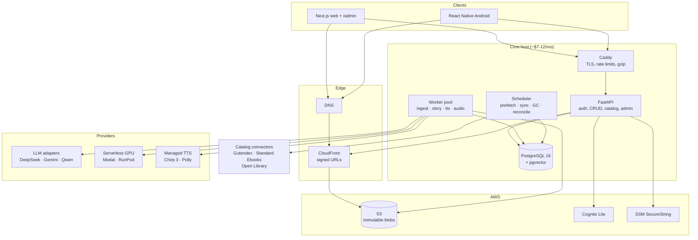
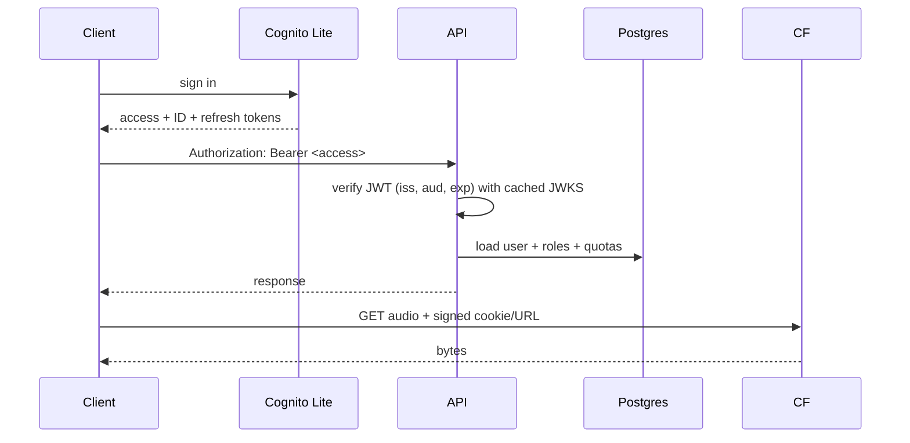
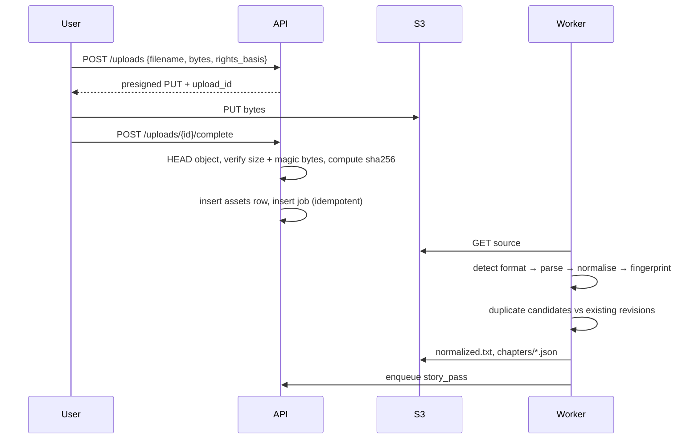
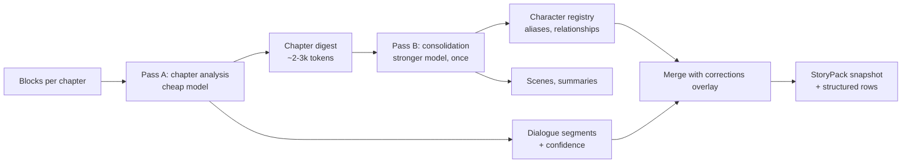
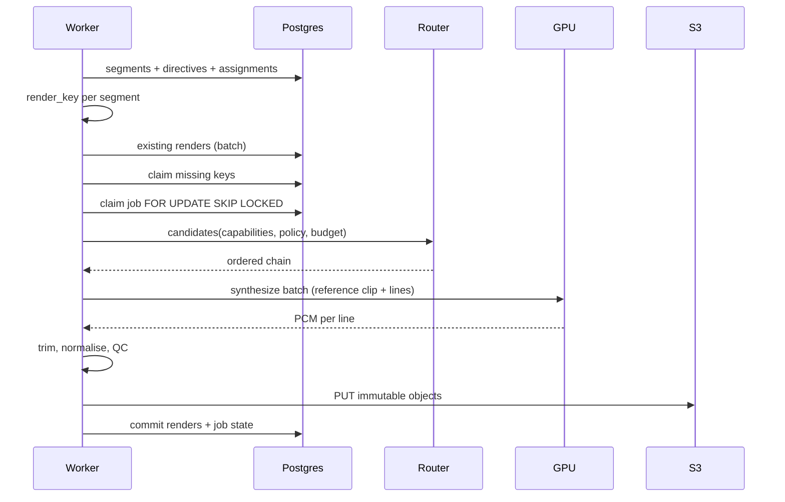
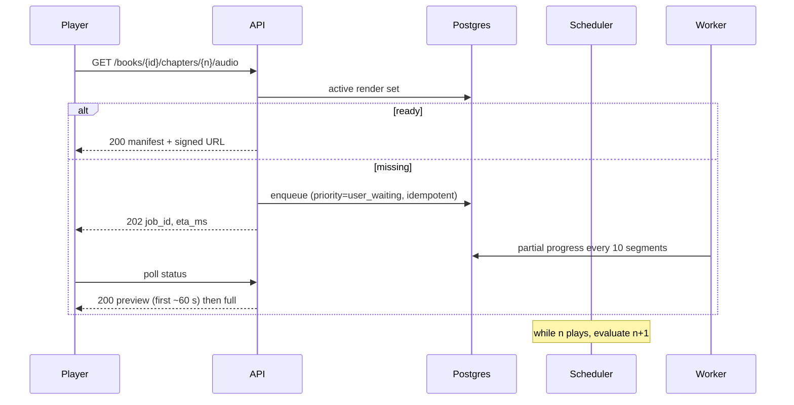

# 02. System Architecture

## 1. Shape

This section describes the **target** architecture. The **launch** architecture is the same
monolith with cheaper adapters underneath it: SQLite and local files, Kokoro on CPU, and no
managed identity. See ADR-0001, ADR-0002 and ADR-0007 for why, and §1.1 for the mapping.

A modular monolith with two process types (API, worker) on one host, backed by S3 for
immutable blobs, CloudFront for delivery, Cognito for identity, and external providers for
inference. See ADR-0001 and ADR-0002 for why.



### 1.1 Launch profile (implemented)

The launch replaces infrastructure with adapters, not with a second architecture. Nothing
above the adapter line changes: the render key, the schema, the job states and the provider
interface are identical.

| Target piece | Launch implementation | Boundary that keeps the swap cheap |
|---|---|---|
| PostgreSQL + pgvector | SQLite 3 (WAL, foreign keys, 5 s busy timeout), same SQLAlchemy metadata | `AAB_DATABASE_URL`; all SQL lives in `aab_db` |
| S3 immutable blobs | local filesystem under `AAB_MEDIA_DIR`, content-addressed paths | path convention and asset rows |
| CloudFront | FastAPI `/media/{path}` with range support | URLs in manifests are relative |
| Cognito | optional shared `AAB_ADMIN_TOKEN`; reads public | one FastAPI dependency |
| Serverless GPU + Qwen3-TTS | Kokoro-82M int8 ONNX on CPU; deterministic fake fallback | `aab_providers.build_provider()` |
| PostgreSQL `SKIP LOCKED` queue | same `jobs` table; guarded `UPDATE … WHERE state='queued'` plus rowcount check | `aab_db.claim_job` |
| Next.js web + admin | one static `apps/web/index.html` served by the API | HTTP API is the contract |
| Scheduler / prefetch | none; on-demand with shared-cache reuse | priority bands already exist in the queue |

Operating shape at launch: one API process, one worker, one disk. A second worker is not a
scaling win on SQLite; it is write contention. When that limit is reached, the migration is
`AAB_DATABASE_URL` → Postgres plus object storage, in that order.

The failure matrix in §5 still applies, with two substitutions: "Postgres down" becomes
"database file unavailable", and "CloudFront/S3 issue" becomes "local disk full or
unreadable". A local disk failure is not survivable from replicas, which is why the backup
runbook exists and why storage migration is the first paid step.

## 2. Components and responsibilities

| Component | Owns | Must not |
|---|---|---|
| `proxy` (Caddy) | TLS, HTTP compression, per-IP rate limits, request size caps | Make authorisation decisions |
| `api` | AuthN/Z, CRUD, catalogue search, library, playback state, job enqueue/status, signed URL issuance, admin endpoints | Run inference, invoke ffmpeg, hold long transactions |
| `worker` | Parsing, story analysis, TTS, mastering, QC, export | Serve user HTTP requests |
| `scheduler` | Prefetch decisions, catalogue sync, stale-lease recovery, GC, cost reconciliation | Business rules that belong in `api` |
| `pg` | Relational state, queue, flags, usage, embeddings | Blob storage |
| `s3` | Immutable bytes with content hashes | Mutable state |
| adapters | Vendor I/O behind protocols | Know about users, jobs or tenancy |

## 3. Module boundaries inside the monolith

```
api/            routes → services → repositories
services/       use cases (start_upload, request_chapter, assign_voice)
repositories/   the only SQL in the system
aab_ingest/     pure functions: bytes → parsed structure
aab_story/      pure-ish: text + blocks + provider → story objects
aab_tts/        pure: segment + voice + model → render key, render plan
aab_audio/      pure: audio parts → mastered artefact (ffmpeg subprocess)
aab_providers/  the only vendor SDKs
aab_jobs/       claim, lease, retry, schedule
```

Dependencies point one way: `api → services → repositories → aab_db`. Domain packages
(`aab_ingest`, `aab_story`, `aab_tts`, `aab_audio`) do not import `api` or `aab_db`; they take
and return plain dataclasses. This is what makes them testable without a database and
extractable later.

## 4. Data flows

### 4.1 Authentication



- Access tokens are short-lived (15 min); refresh rotation is Cognito's.
- Roles are stored in our database, not in the token, so revocation is immediate.
- The audio scope is a separate signed cookie so the CDN can authorise without the app.

### 4.2 Ingestion



Failure handling: a parse failure marks the upload `failed` with a machine-readable reason and
keeps the source file so the user can retry after we fix the parser. Nothing is deleted
automatically.

### 4.3 Story intelligence

Two passes, for cost control and quality:



**Pass A** receives one chapter at a time and returns a strict JSON object validated against a
schema. On validation failure it retries up to three times with the error appended. **Pass B**
never sees the full text; it sees digests. This is the difference between ~$0.40 and ~$40 per
book.

**Corrections** are rows in `story_corrections`, keyed by `(revision_id, span_hash)`, with the
corrected value and the actor. They are applied after every derivation, so reprocessing does
not lose them.

### 4.4 Voice production



Batch size 20–60 segments per call, grouped by voice profile revision and model. Batching is
the difference between ~$1.70 and ~$6 per book on the same GPU.

### 4.5 Playback and prefetch



### 4.6 Admin configuration

Admin write → validate → new `config_version` row → bump counter → processes pick it up within
5 s. Rollback is re-publishing the previous version. In-flight jobs keep the version they
started with (recorded on the job), so a config change never half-applies to a chapter.

## 5. Failure handling

| Failure | Behaviour | User-visible |
|---|---|---|
| LLM 5xx/timeout | 3 retries, then next candidate in chain | Degraded: lower attribution confidence, banner in admin only |
| Chain exhausted | Job fails with taxonomy code | Chapter shows "narration unavailable", other chapters play |
| TTS cold start timeout | Extend lease, retry on warm worker | ETA increases |
| One segment fails | Continue; chapter `ready_with_gaps` | Optional "fix this line" action |
| Worker process dies | Lease expiry → requeue; writes are idempotent | None |
| Postgres down | API 503 + Retry-After; CDN keeps serving audio | "Browsing unavailable" |
| CloudFront/S3 issue | Cached edge objects still serve; origin errors surface as playback retry | Buffering |
| Budget cap hit | Queues pause; cached-only mode | "New narration paused" |
| Provider credential invalid | Health flips to `degraded`; routing avoids it; alert | None |
| Disk full | Object write fails before DB commit; job fails; GC alert | Generation error |

## 6. Observability

- **Structured logs** (JSON) with `request_id`, `user_id` (hashed), `job_id`, `render_key`
  prefix. No text of user books in logs, ever.
- **Metrics** (Prometheus on the host): request latency, job duration by kind, queue depth,
  provider latency/error rate, cache hit ratio, GPU spend, ffmpeg failures.
- **Traces**: OpenTelemetry, sampled at 5%, full sampling for failures. Propagate `job_id`
  across provider calls so one chapter can be reconstructed end to end.
- **Alerts**: queue depth > 100 for 10 min; chapter failure rate > 5% over 30 min; spend > 70%
  of budget; provider health `degraded` > 5 min; disk > 80%.

Distributed tracing is justified only because the pipeline crosses providers where you cannot
read logs. It is not justified for the CRUD API.

## 7. Rejected infrastructure, with reasons

| Component | Why rejected now | Trigger to adopt |
|---|---|---|
| Kafka | Peak is tens of jobs/s; Postgres `SKIP LOCKED` handles thousands | > 5k jobs/s or multi-consumer replay requirements |
| Kubernetes | One deployable, one host | Multi-region or > 3 independently scaled services |
| Dedicated vector DB | pgvector suffices to 10⁷ vectors | Measured retrieval p95 > 200 ms at 10⁷ with HNSW tuned |
| API Gateway | Adds cost and a 29 s integration timeout | Public partner API with its own auth/quotas |
| DynamoDB | See ADR-0002 | Multi-region active-active |
| AWS AppConfig | Extra control plane for one flag table | Multi-account fleet needing config distribution |
| SQS | Postgres queue gives transactional enqueue | Fan-out to independent consumers, or > 5k msg/s |
