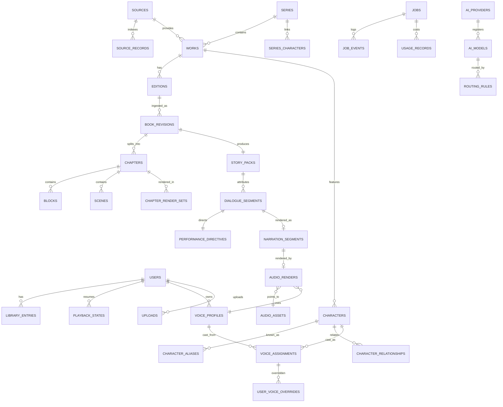

# 03. Data and BookBrain

## 1. Storage split

| Store | Holds | Rule |
|---|---|---|
| PostgreSQL | Everything relational, the job queue, flags, usage, audit, embeddings | Source of truth |
| S3 | Immutable blobs: sources, normalised text, storypack snapshots, audio, exports | Write once, hash-addressed |

No blob is ever mutated. No relational row is ever the only record of an expensive artefact:
every audio object has a row with provenance, and every row points at an object that exists
(write-then-commit).

**Launch note (ADR-0007).** The launch implements the same tables from one SQLAlchemy
metadata (`python/src/aab_db/models.py`) on SQLite, with local files replacing S3. The
mapping is mechanical and deliberate:

| Target | Launch |
|---|---|
| `shared` / `private` / `ops` schemas | no schemas; access is one process with an optional admin token |
| `jsonb` | SQLAlchemy `JSON` (TEXT on SQLite) |
| `timestamptz`, `uuid`, enums | ISO-8601 text, prefixed string ids, `CHECK`/text |
| partial and expression indexes | ordinary indexes; claim queries are written to work on both |
| pgvector embeddings | not populated; the embedding tables are absent at launch |
| S3 object paths | the same relative paths under `AAB_MEDIA_DIR` |

The DDL in this document remains the contract for the Postgres target. When a table is added
to one, it is added to the other in the same change; divergence is a bug, not a migration
strategy.

## 2. Schema boundaries

Three schemas, because "private by default" needs to be enforceable rather than a convention.

| Schema | Contents | Access |
|---|---|---|
| `shared` | Works, editions, revisions, chapters, blocks, storypacks, characters, system voices, renders marked `shareable` | Any authenticated user, read-only |
| `private` | Uploads, private revisions, private renders, user voice references, consent records, playback, library | `owner_id` predicate injected by the repository layer |
| `ops` | Jobs, providers, models, routing, flags, budgets, usage, audit | Service role and admin API only |

Enforcement:

- The app's DB role has no `DELETE`/`UPDATE` on `ops.audit_log`.
- A CI check greps for `private.` outside `repositories/private_*` and fails the build.
- Integration tests attempt cross-tenant reads on every private endpoint and assert 404 (not
  403, to avoid confirming existence).

## 3. Entity relationship diagram



Design notes:

- `dialogue_segments` and `narration_segments` are separate because one is *meaning* (who
  speaks, how) and the other is *rendering intent* (which voice, which key). A correction
  changes the first; a voice swap changes the second.
- `chapter_render_sets` exists so a chapter can have multiple coherent renderings (system
  canonical, user customised) with exactly one active.
- `audio_renders` is the cache. There is no separate `audio_cache_entries` table; a view over
  this table named `audio_cache` serves that purpose without a second source of truth.

## 4. Core DDL

```sql
create schema shared;
create schema private;
create schema ops;

-- ---------- shared ----------
create table shared.assets (
  asset_id        text primary key,               -- as_<ulid>
  kind            text not null,                  -- source_upload | normalized_text | storypack | audio_segment | chapter_master | export | voice_reference | cover
  s3_bucket       text not null,
  s3_key          text not null,
  sha256          bytea not null,
  bytes           bigint not null,
  mime            text not null,
  duration_ms     int,
  created_at      timestamptz not null default now(),
  unique (s3_bucket, s3_key)
);
create index on shared.assets (sha256);

create table shared.sources (
  source_id    text primary key,                  -- src_gutendex
  name         text not null,
  kind         text not null check (kind in ('catalogue','mirror','upload')),
  base_url     text,
  terms_url    text,
  enabled      boolean not null default true,
  last_sync_at timestamptz
);

create table shared.series (
  series_id    text primary key,
  title        text not null,
  author_name  text,
  created_at   timestamptz not null default now()
);

create table shared.works (
  work_id           text primary key,             -- wk_<ulid>
  title             text not null,
  sort_title        text not null,
  original_language text not null,                -- BCP-47
  series_id         text references shared.series(series_id),
  first_published   int,
  rights_basis      text not null check (rights_basis in
                    ('public_domain_us','public_domain_global','licensed','user_owned','unknown')),
  territories       text[] not null default '{}',
  shareable         boolean not null default false,
  created_at        timestamptz not null default now()
);
create index on shared.works using gin (to_tsvector('english', title));

create table shared.editions (
  edition_id   text primary key,
  work_id      text not null references shared.works,
  publisher    text,
  year         int,
  isbn         text,
  language     text not null,
  source_id    text references shared.sources,
  external_id  text,
  unique (source_id, external_id)
);

create table shared.book_revisions (
  revision_id       text primary key,
  edition_id        text not null references shared.editions,
  source_asset_id   text not null references shared.assets,
  content_sha256    bytea not null,
  text_sha256       bytea not null,
  fingerprint       bytea not null,
  parser_version    text not null,
  normalizer_version text not null,
  language          text not null,
  word_count        int not null,
  status            text not null,
  supersedes        text references shared.book_revisions,
  created_at        timestamptz not null default now(),
  unique (text_sha256, parser_version, normalizer_version)
);

create table shared.chapters (
  chapter_id   text primary key,
  revision_id  text not null references shared.book_revisions,
  ordinal      int not null,
  title        text,
  char_start   int not null,
  char_end     int not null,
  word_count   int not null,
  unique (revision_id, ordinal)
);

create table shared.blocks (
  block_id    text primary key,
  chapter_id  text not null references shared.chapters,
  ordinal     int not null,
  kind        text not null check (kind in ('narration','dialogue','heading','verse','epigraph')),
  text        text not null,
  text_hash   bytea not null,
  speaker_hint text,
  unique (chapter_id, ordinal)
);

create table shared.scenes (
  scene_id       text primary key,
  chapter_id     text not null references shared.chapters,
  ordinal        int not null,
  first_block_id text not null references shared.blocks,
  last_block_id  text not null references shared.blocks,
  location       text,
  time_of_day    text,
  summary        text,
  confidence     numeric(4,3) not null default 0,
  unique (chapter_id, ordinal)
);

create table shared.characters (
  character_id   text primary key,
  work_id        text references shared.works,
  series_id      text references shared.series,
  canonical_name text not null,
  role           text,
  description    text,
  speech         jsonb not null default '{}',
  accent         jsonb not null default '{"value": null, "basis": "unknown"}',
  status         text not null default 'auto' check (status in ('auto','curator','user')),
  confidence     numeric(4,3) not null default 0,
  created_at     timestamptz not null default now()
);

create table shared.character_aliases (
  alias_id       text primary key,
  character_id   text not null references shared.characters,
  value          text not null,
  alias_type     text not null,       -- nickname | form_of_address | title | misspelling
  confidence     numeric(4,3) not null,
  evidence_block_ids text[] not null default '{}',
  unique (character_id, value)
);

create table shared.character_relationships (
  relationship_id text primary key,
  from_character  text not null references shared.characters,
  to_character    text not null references shared.characters,
  kind            text not null,      -- parent | sibling | spouse | rival | servant | ...
  description     text,
  evidence_block_ids text[] not null default '{}',
  confidence      numeric(4,3) not null
);

create table shared.dialogue_segments (
  segment_id            text primary key,
  revision_id           text not null references shared.book_revisions,
  chapter_id            text not null references shared.chapters,
  ordinal               int not null,
  first_block_id        text not null references shared.blocks,
  last_block_id         text not null references shared.blocks,
  speaker_id            text references shared.characters,   -- null = unknown
  attribution_method    text not null,  -- quotative | alternation | llm | manual | none
  attribution_confidence numeric(4,3) not null,
  attribution_status    text not null check (attribution_status in
                        ('certain','probable','uncertain','unattributed')),
  evidence_block_ids    text[] not null default '{}',
  unique (chapter_id, ordinal)
);
create index on shared.dialogue_segments (revision_id, speaker_id);
create index on shared.dialogue_segments (chapter_id) where attribution_status = 'uncertain';

-- ---------- narration plan ----------
-- One row per unit of speech that maps to exactly one audio render. Produced
-- deterministically from blocks + story semantics; contains no provider choice.
create table shared.narration_segments (
  segment_id      text primary key,
  revision_id     text not null references shared.book_revisions,
  chapter_id      text not null references shared.chapters,
  ordinal         int not null,
  kind            text not null check (kind in ('narration','dialogue','heading','verse')),
  text            text not null,
  text_hash       bytea not null,
  phon_hash       bytea,                          -- after pronunciation lexicon
  language        text not null,                  -- BCP-47
  speaker_kind    text not null check (speaker_kind in ('narrator','character')),
  character_id    text references shared.characters,
  dialogue_segment_id text references shared.dialogue_segments,
  char_count      int not null,
  gap_after_ms    int not null default 120,
  unique (chapter_id, ordinal)
);
create index on shared.narration_segments (revision_id, character_id);

create table shared.performance_directives (
  segment_id   text primary key references shared.narration_segments,
  emotion      text not null check (emotion in ('neutral','warm','tense','angry','afraid',
                   'sad','joyful','indignant','tender','weary','urgent','amused')),
  intensity    smallint not null check (intensity between 1 and 3),
  pace         text not null check (pace in ('slow','normal','fast')),
  style        text not null check (style in ('plain','clipped','breathy','dramatic','wry')),
  context_note text,                              -- human-readable only, NOT in the render key
  source       text not null check (source in ('rules','llm','curator','user')),
  confidence   numeric(4,3) not null default 1.0
);

-- A coherent set of renders for a chapter. Exactly one is active per scope.
create table shared.chapter_render_sets (
  render_set_id  text primary key,
  chapter_id     text not null references shared.chapters,
  revision_id    text not null references shared.book_revisions,
  scope          text not null check (scope in ('system','user')),
  owner_id       text,
  policy_version text not null,                   -- tts policy: mastering, bitrate, lexicon
  model_family   text not null,                   -- qwen3-tts-1.7b | kokoro-82m | chirp3-hd
  status         text not null check (status in ('draft','rendering','ready',
                   'ready_with_gaps','failed','stale','superseded')),
  is_active      boolean not null default false,
  created_at     timestamptz not null default now(),
  unique (chapter_id, scope, owner_id, policy_version, model_family)
);
create unique index one_active_set on shared.chapter_render_sets
  (chapter_id, scope, coalesce(owner_id, '')) where is_active;

create table shared.story_corrections (
  correction_id  text primary key,
  revision_id    text not null references shared.book_revisions,
  span_hash      bytea not null,          -- of the affected block range
  field          text not null,           -- speaker_id | emotion | is_dialogue | alias ...
  old_value      jsonb,
  new_value      jsonb not null,
  actor_id       text not null,
  created_at     timestamptz not null default now(),
  unique (revision_id, span_hash, field)
);

create table shared.story_packs (
  story_pack_id   text primary key,
  revision_id     text not null unique references shared.book_revisions,
  schema_version  text not null,
  pipeline_version text not null,
  prompt_bundle   text not null,
  asset_id        text references shared.assets,  -- canonical JSON snapshot in S3
  attribution_coverage numeric(4,3),
  needs_review    boolean not null default false,
  created_at      timestamptz not null default now()
);

-- ---------- voice ----------
create table shared.voice_profiles (
  voice_profile_id  text primary key,
  scope             text not null check (scope in ('system','user')),
  owner_id          text,
  character_id      text references shared.characters,
  series_character_id text,
  revision          int not null default 1,
  source_type       text not null check (source_type in ('reference_clone','designed','preset')),
  reference_asset_id text references shared.assets,
  design_prompt     text,
  preset_id         text,
  model_binding     jsonb not null,
  params            jsonb not null default '{}',
  persona           jsonb not null default '{}',
  locked            boolean not null default false,
  status            text not null default 'active',
  created_at        timestamptz not null default now()
);

create table shared.voice_assignments (
  assignment_id   text primary key,
  render_set_id   text not null references shared.chapter_render_sets,
  character_id    text not null references shared.characters,
  voice_profile_id text not null references shared.voice_profiles,
  assigned_by     text not null,
  locked          boolean not null default false
);

create table shared.user_voice_overrides (
  override_id      text primary key,
  user_id          text not null,
  assignment_id    text not null references shared.voice_assignments,
  voice_profile_id text not null references shared.voice_profiles,
  created_at       timestamptz not null default now(),
  unique (user_id, assignment_id)
);

-- ---------- audio ----------
create table shared.audio_renders (
  render_key         text primary key,             -- rk1:<hex>
  segment_id         text not null references shared.narration_segments,
  asset_id           text not null references shared.assets,
  voice_profile_id   text not null,
  voice_profile_rev  int not null,
  model_id           text not null,
  model_version      text not null,
  render_set_id      text not null,
  duration_ms        int not null,
  loudness_lufs      numeric(5,2),
  true_peak_dbtp     numeric(5,2),
  qc_status          text not null check (qc_status in ('passed','failed','failed_drift','skipped')),
  generated_by       text not null check (generated_by in ('system','user','local_device')),
  shareable          boolean not null default false,
  created_at         timestamptz not null default now()
);
create index on shared.audio_renders (segment_id);
create index on shared.audio_renders (render_set_id);

-- ---------- private ----------
create table private.users (
  user_id      text primary key,
  cognito_sub  text not null unique,
  email_hash   bytea not null,                    -- never the raw address
  display_name text,
  role         text not null default 'user'
               check (role in ('user','curator','admin','finance')),
  plan         text not null default 'free',
  created_at   timestamptz not null default now(),
  deleted_at   timestamptz
);

create table private.library_entries (
  user_id  text not null references private.users,
  work_id  text not null references shared.works,
  added_at timestamptz not null default now(),
  primary key (user_id, work_id)
);

create table private.uploads (
  upload_id    text primary key,
  owner_id     text not null,
  filename     text not null,
  asset_id     text references shared.assets,
  rights_basis text not null default 'unknown',
  status       text not null,
  error        jsonb,
  created_at   timestamptz not null default now()
);
create index on private.uploads (owner_id);

create table private.playback_states (
  user_id     text not null,
  book_id     text not null,
  chapter_id  text,
  position_ms int not null default 0,
  speed       numeric(3,2) not null default 1.0,
  device_id   text,
  updated_at  timestamptz not null default now(),
  primary key (user_id, book_id)
);

create table private.voice_consents (
  consent_id   text primary key,
  subject_name text not null,
  owner_id     text not null,
  evidence_key text,          -- signed statement / recording in S3
  scope        text not null,
  expires_at   timestamptz,
  created_at   timestamptz not null default now()
);

-- ---------- ops ----------
create table ops.jobs (
  job_id            text primary key,
  kind              text not null,
  target_type       text not null,
  target_id         text not null,
  priority          smallint not null default 100,
  state             text not null check (state in
                    ('queued','running','succeeded','failed','cancelled','dead')),
  idempotency_key   text not null unique,
  attempts          smallint not null default 0,
  max_attempts      smallint not null default 3,
  lease_owner       text,
  lease_expires_at  timestamptz,
  config_version    bigint not null,
  routing_chain     jsonb,
  estimated_cost_usd numeric(10,5),
  actual_cost_usd    numeric(10,5),
  error             jsonb,
  created_at        timestamptz not null default now(),
  updated_at        timestamptz not null default now()
);
create index jobs_claimable on ops.jobs (priority, created_at) where state = 'queued';
create index jobs_stale on ops.jobs (lease_expires_at) where state = 'running';

create table ops.audit_log (
  audit_id    bigint generated always as identity primary key,
  actor_id    text not null,
  actor_role  text not null,
  action      text not null,
  target_type text not null,
  target_id   text not null,
  before      jsonb,
  after       jsonb,
  reason      text,
  request_id  text,
  created_at  timestamptz not null default now()
);

create table ops.config_versions (
  version     bigint primary key,
  actor_id    text not null,
  note        text,
  diff        jsonb,
  created_at  timestamptz not null default now()
);

create table ops.feature_flags (
  key         text primary key,
  value       jsonb not null,
  description text,
  updated_by  text not null,
  updated_at  timestamptz not null default now()
);

create table ops.ai_providers (
  provider_id       text primary key,             -- deepseek | google | modal | runpod | polly
  kind              text not null check (kind in ('llm','tts','embedding','ocr')),
  display_name      text not null,
  auth_ref          text,                         -- SSM parameter name; never the secret
  enabled           boolean not null default true,
  health            text not null default 'unknown'
                    check (health in ('healthy','degraded','down','unknown')),
  health_checked_at timestamptz,
  health_detail     jsonb,
  created_at        timestamptz not null default now()
);

create table ops.ai_models (
  model_id       text not null,
  provider_id    text not null references ops.ai_providers,
  version        text not null,
  kind           text not null,
  display_name   text not null,
  capabilities   jsonb not null,
  limits         jsonb not null default '{}',
  price_schedule jsonb not null,                  -- [{effective_from, unit, ...rates}]
  weights_sha256 text,
  licence        text not null,
  terms_version  text,
  data_class     text not null default 'public_ok'
                 check (data_class in ('public_ok','no_training','private_ok')),
  deprecated_at  timestamptz,
  enabled        boolean not null default true,
  primary key (model_id, version)
);

create table ops.routing_rules (
  rule_id      text primary key,
  capability   text not null,                     -- llm.chapter_analysis | tts.clone | embedding.text
  requirements jsonb not null,                    -- languages, cloning, min_context, streaming
  chain        jsonb not null,                    -- ordered [{provider_id, model_id, version}]
  active       boolean not null default true,
  updated_by   text not null,
  updated_at   timestamptz not null default now()
);

create table ops.budgets (
  budget_id  text primary key,
  scope      text not null check (scope in ('global','provider','user','book')),
  scope_id   text,
  period     text not null check (period in ('day','month')),
  cap_usd    numeric(10,2) not null,
  hard_stop  boolean not null default true,
  created_at timestamptz not null default now(),
  unique (scope, scope_id, period)
);

create table ops.usage_records (
  usage_id      bigint generated always as identity primary key,
  job_id        text references ops.jobs,
  provider_id   text not null,
  model_id      text not null,
  model_version text not null,
  unit          text not null,                    -- tokens_in | tokens_out | chars | gpu_seconds
  quantity      numeric(14,4) not null,
  cost_usd      numeric(10,6) not null,
  cache_read    boolean not null default false,
  created_at    timestamptz not null default now()
);
create index on ops.usage_records (created_at);
create index on ops.usage_records (provider_id, created_at);

create table ops.job_events (
  event_id   bigint generated always as identity primary key,
  job_id     text not null references ops.jobs,
  event      text not null,
  detail     jsonb,
  created_at timestamptz not null default now()
);

-- Short-lived claim on a render key, so two workers that need the same line do not
-- both pay for it. Expires so a dead worker cannot block a key forever.
create table ops.render_claims (
  render_key text primary key,
  job_id     text not null references ops.jobs,
  claimed_at timestamptz not null default now(),
  expires_at timestamptz not null
);
create index on ops.render_claims (expires_at);
```

## 5. Queue semantics

Claim (atomic, no external broker):

```sql
with claimed as (
  select job_id from ops.jobs
  where state = 'queued'
    and kind = any($2)
  order by priority asc, created_at asc
  for update skip locked
  limit 1
)
update ops.jobs j
   set state = 'running',
       lease_owner = $1,
       lease_expires_at = now() + interval '15 minutes',
       attempts = attempts + 1,
       updated_at = now()
  from claimed
 where j.job_id = claimed.job_id
returning j.*;
```

Rules:

- `idempotency_key` is unique, so a duplicate enqueue returns the existing job rather than
  creating work.
- The worker renews the lease every 60 s while alive; a 15-minute lease tolerates a long GPU
  call without a false positive but recovers a dead worker quickly.
- A sweep requeues `running` jobs whose lease has expired; if `attempts >= max_attempts`,
  the job becomes `dead` and an alert fires.
- Priority bands: `user_waiting` 10, `prefetch` 50, `curation` 200. A curation batch checks
  the `user_waiting` depth before each chapter and yields if it exceeds the threshold.

## 6. S3 layout

```
s3://aab-{env}/
  catalog/{source}/{external_id}/meta.json
  catalog/{source}/{external_id}/source.{epub|txt}
  works/{work_id}/editions/{edition_id}/revisions/{revision_id}/
      source.{ext}
      normalized.txt
      chapters/{ordinal:04d}.json
      storypack/{schema_version}.json.zst
      artifacts/manifest.json
  voices/{scope}/{voice_profile_id}/r{revision}/reference.wav
  audio/{model_key}/{rk[0:2]}/{rk}.opus
  audio/chapters/{render_set_id}/{chapter_id}/master.m4a
  audio/chapters/{render_set_id}/{chapter_id}/manifest.m3u8
  exports/{book_id}/{render_set_id}/book.m4b
  private/{user_id}/uploads/{upload_id}/source.{ext}
  private/{user_id}/voices/{voice_profile_id}/reference.wav
```

- Two-character hash prefix avoids hot prefixes and keeps listings small.
- Immutability is enforced by the storage wrapper: `put_if_absent(key, bytes)` fails if the key
  exists.
- Lifecycle: `exports/` and superseded `audio/chapters/` → expire after 30 days;
  `audio/{...}/*.opus` persists until a GC pass proves no active render set references it.

## 7. JSON contracts

Canonical schemas live in `packages/contracts/schemas/` and are generated from Pydantic.
Abridged shapes:

### StoryPack

```json
{
  "story_pack_id": "sp_01JB8Z3K4Q",
  "schema_version": "1.2.0",
  "revision_id": "rev_01JB8Z1A",
  "work_id": "wk_01JB8Z0C",
  "language": "en",
  "pipeline": {
    "version": "si-0.9.1",
    "prompt_bundle": "si-2026-11-a",
    "passes": [
      {"role": "chapter_analysis", "provider": "deepseek", "model": "deepseek-flash", "version": "V4.1-1017"},
      {"role": "work_consolidation", "provider": "google", "model": "gemini-3.5-flash-lite", "version": "2026-07"}
    ]
  },
  "chapters": [
    {"chapter_id": "ch_003", "ordinal": 3, "title": "Chapter Three",
     "summary": "Elizabeth confronts Darcy at Rosings.",
     "scene_ids": ["sc_003_1"], "segment_count": 412, "dialogue_ratio": 0.38}
  ],
  "character_ids": ["chr_7f3a", "chr_11b2"],
  "continuity": {"series_id": null, "unresolved_threads": [], "unlinked_mentions": 6},
  "quality": {"attribution_coverage": 0.87, "unattributed_segments": 41,
              "mean_confidence": 0.78, "needs_review": true},
  "created_at": "2026-11-17T10:12:00Z"
}
```

### Character

```json
{
  "character_id": "chr_7f3a",
  "scope": {"work_id": "wk_01JB8Z0C", "series_id": null},
  "canonical_name": "Elizabeth Bennet",
  "role": "protagonist",
  "aliases": [
    {"value": "Lizzy", "type": "nickname", "confidence": 0.96,
     "evidence_block_ids": ["blk_0012"], "status": "confirmed"}
  ],
  "description": {"text": "Second Bennet daughter; quick-witted and ironic.",
                  "evidence_block_ids": ["blk_0031"]},
  "speech": {"register": "educated Regency English", "pace": "measured",
             "notes": "dry humour, trails off when embarrassed"},
  "accent": {"value": null, "basis": "insufficient_evidence"},
  "status": "auto",
  "confidence": 0.93,
  "identity_links": []
}
```

### VoiceProfile

```json
{
  "voice_profile_id": "vp_01JB9Q2M",
  "scope": {"type": "system", "owner_id": null},
  "character_id": "chr_7f3a",
  "revision": 3,
  "voice_source": {
    "type": "reference_clone",
    "reference_asset_id": "as_01JB9Q1T",
    "reference_sha256": "b1946ac92492d2347c6235b4d2611184",
    "reference_duration_ms": 8400,
    "reference_transcript": "I have been used to consider poetry as the food of love."
  },
  "model_binding": {
    "model_id": "qwen3-tts-1.7b-base",
    "weights_sha256": "9f86d081884c7d659a2feaa0c55ad015",
    "allowed_models": ["qwen3-tts-1.7b-base", "qwen3-tts-0.6b-base"]
  },
  "params": {"seed": 1234, "temperature": 0.7, "top_p": 0.9, "speed": 1.0},
  "persona": {
    "timbre": "clear mid-range alto", "pitch": "mid",
    "accent": "en-GB", "language": "en-GB",
    "pronunciation_set_id": "pr_01JB9Q4C",
    "delivery_defaults": {"pace": "measured", "energy": "restrained"}
  },
  "locked": true,
  "consent": {"required": false, "record_id": null},
  "status": "active"
}
```

### NarrationSegment

```json
{
  "segment_id": "sg_01JBA0F7",
  "chapter_id": "ch_003",
  "ordinal": 214,
  "block_ids": ["blk_8812"],
  "kind": "dialogue",
  "text": "You are mistaken, Mr. Darcy.",
  "text_hash": "sha256:5c1f9a",
  "speaker": {
    "type": "character",
    "character_id": "chr_7f3a",
    "attribution": {"method": "quotative_rule", "confidence": 0.94, "status": "certain"}
  },
  "directive": {
    "emotion": "indignant", "intensity": 2, "pace": "normal", "style": "clipped",
    "context": "public rebuke, controlled anger",
    "pronunciation_overrides": []
  },
  "render_key": "rk1:9f2c41d7a0be",
  "render_status": "ready",
  "audio_render_id": "ar_01JBA0G1"
}
```

### AudioAsset

```json
{
  "asset_id": "as_01JBA0H2",
  "kind": "chapter_master",
  "storage": {"bucket": "aab-prod", "key": "audio/chapters/rs_7c1/ch_003/master.m4a",
              "region": "us-east-1"},
  "bytes": 7123456,
  "sha256": "e3b0c44298fc1c149afbf4c8996fb924",
  "container": "m4a", "codec": "aac_lc",
  "sample_rate": 24000, "channels": 1, "bitrate_kbps": 64,
  "duration_ms": 1184000,
  "loudness_lufs": -19.0, "true_peak_dbtp": -3.1,
  "provenance": {
    "render_set_id": "rs_7c1",
    "job_ids": ["job_01JBA0C9"],
    "providers": [{"id": "modal", "model": "qwen3-tts-1.7b-base",
                   "weights_sha256": "9f86d0"}],
    "voice_profile_ids": ["vp_01JB9Q2M", "vp_narrator_sys"],
    "pipeline_version": "tts-0.4.2",
    "generated_at": "2026-11-17T10:41:00Z",
    "generated_by": "system",
    "rights_basis": "public_domain_us",
    "territories": ["US"],
    "shareable": true
  },
  "qc": {"status": "passed",
         "checks": ["duration_sane","silence_ratio","clipping","loudness","asr_roundtrip"]}
}
```

## 8. Versioning

| Axis | Where recorded | Invalidates |
|---|---|---|
| `schema_version` | storypack, contracts | Readers and migrations |
| `pipeline_version` | derived rows, jobs | Derived artefacts (recompute) |
| `prompt_bundle` | storypack.pipeline | Story analysis only |
| `model_version` + `weights_sha256` | render rows, assets | Audio |
| `parser_version` / `normalizer_version` | book_revisions | Text, therefore everything downstream |

Reprocessing is additive. A new revision or storypack row is created with `supersedes` set;
old assets remain until GC. Rollback is repointing `active_revision_id`, not editing history.

## 9. Deduplication

| Level | Key | Action on match |
|---|---|---|
| File | `assets.sha256` | Reuse asset, skip upload storage |
| Edition | `text_sha256 + parser_version + normalizer_version` | Reuse revision |
| Work (cross-edition) | Shingle fingerprint, Jaccard ≥ 0.92 | Propose a merge to a curator; never auto-merge |
| Audio | `render_key` | Reuse render |

Fingerprint method: 64-bit hashes of 5-grams over normalised text, MinHash with 128
permutations, compared against candidates sharing a title/author trigram bucket. Exact
comparison is only run on candidates, never all-pairs.

## 10. Multi-user separation summary

- `shared` rows are readable by anyone authenticated **only** when `shareable = true` and the
  territory check passes.
- `private` rows require `owner_id = current_user`.
- `ops` requires a service role or the `admin`/`finance` role.
- Derived artefacts inherit the most restrictive rights of their inputs: a render of a private
  upload is never `shareable`, regardless of the TTS model's licence.
- Deleting an account writes a manifest of all objects under `private/{user_id}/` and deletes
  by prefix; shared contributions already legitimately published are retained but de-identified.
