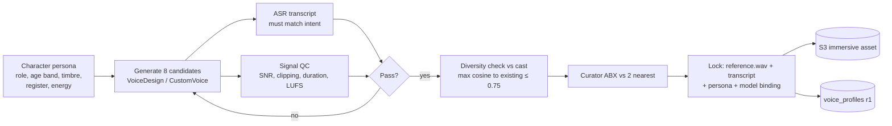

# 04. AI Providers, Models and Voices

## 1. Scope

This document covers everything that talks to a model: the four provider protocols, the
capability registry, routing, model selection, the voice-casting factory, and the benchmark
protocol that gates Phase 1.

The governing rule is ADR-0005: **vendor SDKs exist only inside `python/aab_providers`**, and
**no model name or price is hard-coded outside the registry**. If you find yourself writing
`if model == "gemini-..."` in application code, the design has been violated.

Everything below is model-agnostic. The named models are the *current* answers produced by
the selection procedure in §7 and §8, not assumptions baked into the code.

### 1.1 What the $0 launch actually runs

No LLM adapter is enabled at launch. Story intelligence is deterministic code in
`aab_story`: quotative tags, single-mention resolution, gender priors from nearby pronouns,
and two-hander alternation. This is a deliberate quality trade, not a stub — it produces
usable attribution and records `method` plus `confidence` on every segment so a later model
can be compared against it.

Speech is Kokoro-82M int8 ONNX on CPU (Apache-2.0, ~116 MB of weights, no account). It
provides real multi-voice narration with one preset per cast member. If the weights are
missing, `build_provider()` returns a deterministic formant synthesiser so that ingest,
segmentation, caching and playback can still be exercised; that fallback is reported by
`/api/health` and recorded as its own `model_family`, and it is never presented as the
quality tier.

Two consequences for the rest of this document:

- The GPU Qwen3-TTS path and every LLM row in §7–§8 are **post-launch opt-ins**. Their
  selection reasoning stands; their activation does not.
- Every price and model identifier stays in the registry. Enabling one is a configuration
  and adapter change, not a job-path change. A new model family produces a new render set,
  never a mixed-voice chapter (ADR-0004, §5.1).

## 2. The four protocols

```python
# python/aab_providers/base.py
from __future__ import annotations
from dataclasses import dataclass
from enum import StrEnum
from typing import Iterator, Protocol, Sequence

class ErrorCode(StrEnum):
    RATE_LIMITED    = "rate_limited"
    UNAVAILABLE     = "unavailable"
    TIMEOUT         = "timeout"
    INVALID_INPUT   = "invalid_input"
    CONTENT_REJECTED = "content_rejected"
    AUTH            = "auth"
    QUOTA_EXCEEDED  = "quota_exceeded"
    UNKNOWN         = "unknown"

@dataclass(frozen=True)
class ProviderError(Exception):
    code: ErrorCode
    message: str                 # provider-facing, already redacted
    provider_id: str
    retryable: bool
    retry_after_ms: int | None = None
    request_id: str | None = None

@dataclass(frozen=True)
class Health:
    status: str                  # healthy | degraded | down | unknown
    latency_ms: int | None
    detail: dict
    checked_at: str

@dataclass(frozen=True)
class Estimate:
    cost_usd: float
    unit: str                    # tokens_in | tokens_out | chars | gpu_seconds
    quantity: float
    price_version: str           # which price_schedule entry was used
    confidence: str              # exact | bounded | rough

class LLMProvider(Protocol):
    id: str
    def capabilities(self) -> dict: ...
    def health(self) -> Health: ...
    def estimate(self, req: "LLMRequest") -> Estimate: ...
    def complete(self, req: "LLMRequest") -> "LLMResult": ...
    def stream(self, req: "LLMRequest") -> Iterator["LLMDelta"]: ...

class TTSProvider(Protocol):
    id: str
    def capabilities(self) -> dict: ...
    def health(self) -> Health: ...
    def estimate(self, req: "TTSRequest") -> Estimate: ...
    def synthesize(self, req: "TTSRequest") -> "TTSResult": ...

class EmbeddingProvider(Protocol):
    id: str
    def capabilities(self) -> dict: ...
    def health(self) -> Health: ...
    def estimate(self, req: "EmbeddingRequest") -> Estimate: ...
    def embed(self, req: "EmbeddingRequest") -> "EmbeddingResult": ...

class OCRProvider(Protocol):
    id: str
    def capabilities(self) -> dict: ...
    def health(self) -> Health: ...
    def estimate(self, req: "OCRRequest") -> Estimate: ...
    def extract(self, req: "OCRRequest") -> "OCRResult": ...
```

Three deliberate omissions:

- **No generic `invoke()`.** It is the escape hatch that destroys the abstraction.
- **No streaming on TTS.** Chapter audio is assembled from segment files; token-level audio
  streaming buys nothing the player cannot get from a manifest and prefetch.
- **No provider-specific kwargs.** Anything a model needs goes in `params`, validated against
  the registry's `limits` document.

### 2.1 TTS request and result

```python
@dataclass(frozen=True)
class TTSLine:
    line_id: str                 # narration segment id
    text: str                    # already normalised, lexicon applied
    language: str                # BCP-47
    emotion: str
    intensity: int               # 1..3
    pace: str                    # slow | normal | fast
    style: str
    seed: int

@dataclass(frozen=True)
class TTSRequest:
    model_id: str
    model_version: str
    voice: "VoiceConditioning"   # reference clip bytes + transcript, or preset id
    lines: Sequence[TTSLine]     # batch, 1..N
    params: dict                 # temperature, top_p, speed, max_new_tokens
    output: str = "pcm_s16le"
    sample_rate: int = 24000

@dataclass(frozen=True)
class TTSResult:
    parts: Sequence["AudioPart"] # one per line, in order
    model_id: str
    model_version: str
    weights_sha256: str
    sample_rate: int
    provider_request_id: str
    gpu_seconds: float
    estimate: Estimate
```

`weights_sha256` is returned by the adapter and asserted against the registry row. If it does
not match, the render key would be a lie, so the adapter raises `INVALID_INPUT` and the job
fails rather than caching audio under the wrong identity.

### 2.2 Batching is part of the protocol

`lines` is a sequence, not a single string, because batching 20–60 lines per call is the
difference between ~$1.70 and ~$6 per book on the same GPU. Adapters that cannot batch
(most managed APIs) declare `max_batch_lines: 1` in capabilities, and the caller degrades to
one line per call without a code change.

## 3. Capability documents

`ops.ai_models.capabilities` is a free-form JSONB document defined per kind. It is the only
place the router learns what a model can do.

### 3.1 TTS capabilities

```json
{
  "kind": "tts",
  "languages": ["en", "zh", "ja", "ko", "de", "fr", "ru", "pt", "es", "it"],
  "voice_sources": ["reference_clone", "preset", "designed"],
  "min_reference_ms": 3000,
  "max_reference_ms": 15000,
  "requires_reference_transcript": true,
  "max_chars_per_line": 480,
  "max_batch_lines": 60,
  "max_batch_chars": 12000,
  "sample_rates": [24000],
  "emotion_control": "discrete",     // discrete | prompt | none
  "supported_emotions": ["neutral","warm","tense","angry","afraid","sad","joyful",
                         "indignant","tender","weary","urgent","amused"],
  "pace_control": "rate_multiplier",
  "deterministic_seed": true,
  "streaming": false,
  "watermark": "none",
  "weights_sha256": "9f86d081884c7d659a2feaa0c55ad015a3bf4f1b2b0b822cd15d6c15b0f00a08"
}
```

### 3.2 LLM capabilities

```json
{
  "kind": "llm",
  "context_tokens": 131072,
  "max_output_tokens": 16384,
  "json_schema": true,
  "json_schema_strict": true,
  "tool_calls": false,
  "streaming": true,
  "languages": ["en", "zh", "es", "fr", "de", "ja", "ko", "ru", "pt", "it", "ar", "hi"],
  "data_class": "no_training",
  "prompt_cache": true,
  "off_peak_discount": true
}
```

`data_scope` is enforced, not advisory: a private upload is only routed to models whose
registry row has `data_class` in `{no_training, private_ok}`. That check happens in the
router, before the call, and is covered by a test.

## 4. Error taxonomy and retry policy

Adapters translate every vendor failure into `ErrorCode`. The router, the job runner and the
admin UI only ever see these eight codes.

| Code | Typical cause | Retry | Fallback | Surfaces as |
|---|---|---|---|---|
| `RATE_LIMITED` | 429, concurrency cap | yes, honour `Retry-After`, jittered | other candidate after 2 attempts | job stays `queued`/`running` |
| `UNAVAILABLE` | 5xx, worker crash, model unloaded | yes, exponential 2/8/30 s | yes | `degraded` |
| `TIMEOUT` | cold start, long queue | yes, once with extended lease | yes | ETA increases |
| `INVALID_INPUT` | schema violation, text too long, mismatched weights hash | no | no | job fails, bug alert |
| `CONTENT_REJECTED` | provider moderation | no | only to a provider with a documented policy difference | chapter gap + review queue |
| `AUTH` | bad/expired credential | no | no | provider `down`, admin alert |
| `QUOTA_EXCEEDED` | hard cap, billing limit | no | no | queue pauses, budget alert |
| `UNKNOWN` | anything unmapped | once | yes | logged with body hash |

Rules:

- Retries are bounded by `attempts < max_attempts` (default 3) **and** by a per-job wall-clock
  budget, so a pathological provider cannot hold a lease forever.
- Error bodies are truncated to 512 bytes and redacted before storage; a provider echoing the
  prompt must not put book text in the job row.
- `CONTENT_REJECTED` on a public-domain classic is a signal that the text normaliser produced
  something wrong (e.g. a slur in an 1890 novel). It is routed to human review, never silently
  retried against another vendor hoping for a different answer.

## 5. Routing

Routing is a pure function. Given the requirements, the active policy, current health and
remaining budget, it returns an ordered candidate list. It performs no I/O.

```python
def candidates(
    requirement: Requirement,          # capability, languages, data_class, min_context, cloning
    rules: list[RoutingRule],          # ops.routing_rules, active, matching capability
    models: dict[ModelKey, ModelRow],
    health: dict[ProviderId, Health],
    budget: BudgetState,
    now: datetime,
) -> list[ModelKey]:
    out = []
    for rule in sorted(rules, key=lambda r: (r.priority, r.rule_id)):
        for cand in rule.chain:
            model = models.get(cand.key)
            if model is None or not model.enabled or model.deprecated_at:
                continue
            if not satisfies(requirement, model):        # hard capability filter
                continue
            if model.data_class not in requirement.allowed_data_classes:
                continue
            if health[model.provider_id].status == "down":
                continue
            if budget.exhausted(model.provider_id):
                continue
            out.append(cand.key)
    # health-weighted: healthy before degraded, then chain order, then price
    return sorted(out, key=lambda k: (health[k.provider].status != "healthy",))
```

Properties that make this testable:

- **Deterministic.** Same inputs, same list. No randomness, no "least recently used" state.
- **Explainable.** `explain(requirement) -> list[(model, verdict, reason)]` powers the admin
  "why did this route here?" panel.
- **Persisted.** The resolved chain is written to `ops.jobs.routing_chain` at claim time, so a
  render can always be explained after prices and health have changed.

### 5.1 Fallback is a policy decision, not an accident

| Situation | Behaviour |
|---|---|
| LLM call fails mid-chapter | Fall through the chain. A chapter analysed by a mix of models is acceptable: story objects are validated against the same schema and carry their own provenance. |
| TTS call fails mid-chapter | **Do not** fall back to a different model inside an active render set. Finish on the primary, or mark the set `stale` and start a new one, and tell the user (ADR-0004 §4). |
| Primary model removed from registry | Existing render sets keep working (audio is immutable). New sets use the new chain. |
| Budget exhausted | Chain is empty → job requeues with `paused`, no error. Cached playback unaffected. |

## 6. Model and price registry

`ops.ai_models.price_schedule` is an ordered array; the entry in force is the last one whose
`effective_from` is not in the future. This is why a price change is a row insert, not a
deploy.

```json
{
  "model_id": "deepseek-v4.1-flash",
  "provider_id": "deepseek",
  "version": "V4.1-1017",
  "kind": "llm",
  "licence": "proprietary-api",
  "terms_version": "2026-09-01",
  "data_class": "no_training",
  "limits": { "context_tokens": 131072, "max_output_tokens": 16384 },
  "price_schedule": [
    {
      "effective_from": "2026-10-01T00:00:00Z",
      "currency": "USD",
      "unit_scale": 1000000,
      "input": 0.15,
      "cached_input": 0.02,
      "output": 0.60,
      "note": "off-peak tier; peak tier is recorded as a separate entry"
    },
    {
      "effective_from": "2027-01-01T00:00:00Z",
      "currency": "USD",
      "unit_scale": 1000000,
      "input": null,
      "output": null,
      "note": "PLACEHOLDER: must be filled before 2027-01-01 or the model is disabled"
    }
  ]
}
```

Null prices are deliberate: an unpriced model is disabled by the router rather than being
silently billed at a stale rate. `docs/CHECKLIST.md` tracks the price re-verification dates.

### 6.1 Drift detection

A nightly probe per enabled model:

1. makes one minimal real call (≤ 64 tokens, ≤ 20 chars of TTS),
2. compares the declared capabilities against observed behaviour (`json_schema` actually
   honoured? `max_batch_lines` actually accepted? sample rate as declared?),
3. writes the result to `health_detail`, and flips `health` to `degraded` on mismatch,
4. costs cents per month and catches the failure mode where a provider silently changes a
   default.

## 7. LLM selection

### 7.1 Requirements

| Role | Input | Output | Constraint |
|---|---|---|---|
| `chapter_analysis` (Pass A) | 1 chapter (~3k–12k tokens) + schema + instructions | ~1–3k tokens JSON | cheap, strict JSON, high recall on attribution |
| `work_consolidation` (Pass B) | digests of all chapters (~2–3k tokens each) | character registry, series links | stronger reasoning, called once per book |
| `attribution_repair` | ambiguous spans + candidate cast | single decision + confidence | low latency, cheap |
| `correction_assist` | user edit + neighbours | proposed propagation | on demand only |

### 7.2 Candidates

| Model | Context | Structured output | Licence/terms | Data class | Role |
|---|---|---|---|---|---|
| DeepSeek V4.1 Flash | 128k | strict JSON schema | proprietary API, off-peak tier | no_training | **Pass A primary** |
| Gemini 3.5 Flash-Lite | 1M+ | JSON schema | proprietary API | no_training | Pass A fallback |
| Gemini 3.8 Flash | 1M+ | JSON schema | proprietary API, price steps up 2027-01-01 | no_training | **Pass B primary** |
| Qwen3.8-Flash | 256k+ | JSON schema | proprietary API | verify | Pass A/B alternate |
| Qwen3-8B (self-hosted) | 32k | grammar-constrained | Apache-2.0 | private_ok | private-upload path, offline dev |

Prices are **not** restated here. They live in `ops.ai_models.price_schedule` and the cost
model in spec 07 reads them at runtime. Restating them in prose is how documentation starts
lying.

### 7.3 Why the two-pass split

Pass A sees one chapter at a time and is the volume cost: ~500k characters per novel, ~125k
input tokens, with ~30–60k output tokens across chapters. Pass B sees only digests: ~20k
tokens total regardless of book length.

Modelled at the verified DeepSeek off-peak rate ($0.15 input / $0.60 output per million
tokens), one pass over a 500k-character novel is:

```
input   125,000 tok × $0.15/M = $0.019
output   40,000 tok × $0.60/M = $0.024
                          total ≈ $0.043
```

With JSON-repair retries, a second pass for uncertain chapters, and Pass B, the realistic
figure is **$0.10–0.50 per book**. This is an *Assumption* until the Phase 0 evaluation set
produces measured token counts. It is also the reason the pipeline never sends a whole book
to a large model: that would be two to three orders of magnitude more expensive for a
quality gain nobody has measured.

### 7.4 Prompt contract

- The model returns **one** JSON object matching a schema generated from Pydantic. No prose,
  no markdown fences.
- On validation failure: retry with the validator's error appended, max 3 attempts, then
  record `analysis_incomplete` for that chapter and continue. The book still ships.
- Temperature 0.2 for analysis, 0 for repair. `seed` is sent where supported but never relied
  on for reproducibility — the recorded inputs are.
- Book text is **untrusted input**. It is wrapped in explicit delimiters, instructions are
  never concatenated from book text, and the model is given no tools. Prompt-injection
  resistance is a property of the contract: the output schema is validated, so an injected
  instruction can at worst produce a wrong attribution, which the confidence field and the
  correction overlay exist to handle.
- `prompt_bundle` (e.g. `si-2026-11-a`) is recorded on every storypack. Changing a prompt is
  a new bundle, and comparisons run against the evaluation set before it ships.

## 8. TTS selection

### 8.1 Candidates

| Model | Licence | Cloning | Languages | Control | Quality | Role |
|---|---|---|---|---|---|---|
| Qwen3-TTS 1.7B Base | Apache-2.0 | 3 s reference | 10 | ref + params | reference-quality | **Primary server model** |
| Qwen3-TTS 0.6B Base | Apache-2.0 | 3 s reference | 10 | ref + params | slightly lower | bulk/curation, previews |
| Qwen3-TTS CustomVoice | Apache-2.0 | 9 presets | 10 | preset + instruct | good | narrator auditions |
| Qwen3-TTS VoiceDesign | Apache-2.0 | text → voice | 10 | prompt | variable | **voice factory only** |
| Kokoro-82M | Apache-2.0 | none | en (+limited) | preset | good for size | on-device, cheap fallback |
| Chatterbox | MIT | yes | en-first | ref | good | alternate |
| CosyVoice 3 | Apache-2.0 | yes | multilingual | ref + instruct | competitive | alternate |
| Piper | MIT engine | per-voice | many | preset | robotic-ish | offline only, per-voice licence audit |
| Google Chirp 3 HD | proprietary | no (studio voices) | 30+ | preset | very good | managed fallback |
| Amazon Polly Neural | proprietary | no | 30+ | preset (NTTS) | good | managed fallback |
| ElevenLabs | proprietary | yes | 30+ | preset/clone | very good | **not at launch** (cost + cloning policy) |

Excluded at the licence layer: XTTS-v2 (CPML, non-commercial), F5-TTS (CC-BY-NC weights).
See `docs/licences/register.md`.

### 8.2 Cost per audio hour

Derivation, not estimation-by-vibes. One audio hour ≈ 50,000 characters. Self-hosted cost is
GPU time, and GPU time is RTF (real-time factor) × 3,600 s.

```
cost_per_audio_hour = rtf × 3600 s × (gpu_usd_per_hour / 3600) × (1 + overhead)
```

| Model | Hardware | RTF | GPU $/h | Cost/audio h | +20% QC/retry |
|---|---|---|---|---|---|
| Qwen3-TTS 1.7B | L4 24 GB (Modal) | 0.15 *(assumption)* | 0.80 | $0.12 | $0.14 |
| Qwen3-TTS 1.7B | L4 24 GB (Modal) | 0.35 *(assumption)* | 0.80 | $0.28 | $0.34 |
| Qwen3-TTS 0.6B | L4 24 GB | 0.10 *(assumption)* | 0.80 | $0.08 | $0.10 |
| Kokoro-82M | T4/A10 | ~0.02 *(assumption)* | 0.60 | $0.012 | $0.015 |
| Kokoro-82M | Android GPU | — | 0 | $0 | $0 |
| Chirp 3 HD | managed | — | — | $1.50 | $1.50 |
| Polly Neural | managed | — | — | ~$0.80 *(verify)* | $0.80 |
| ElevenLabs | managed | — | — | $2.00–4.00 | same |

**The RTF rows are the single most important unverified number in the project.** At RTF 0.15
the product is comfortably viable; at RTF 0.35 with a cold start per chapter it is marginal
for long-tail titles. §15 is the protocol that replaces these assumptions with measurements
before Phase 1 code is written.

Reference point: a 10-hour novel costs **$1.20–3.40** self-hosted and **$16–41** on managed
TTS. That 10× gap is why the primary path is self-hosted and the managed path is a fallback
with a visible price.

## 9. Voice strategy

### 9.1 Three sources of voice identity

| Source | When | Persistence |
|---|---|---|
| `preset` | managed providers, quick previews | `preset_id` in the key |
| `designed` | manufacturing a reference clip | prompt hash in the key; the *clip* is promoted to `reference_clone` |
| `reference_clone` | every production render | clip sha256 in the key |

`designed` is used at casting time only. Production renders always condition on a stored
clip (ADR-0003), because a clip is a point in voice space and a prompt is a distribution.

### 9.2 Casting factory



Why 8 and not 1: instruction-conditioned generation is high-variance. The cost of eight
10-second clips is a few cents; the cost of a bad protagonist voice is the whole book.

Why the diversity check: without it, a model asked for "warm middle-aged man" eight times
produces eight variations of the same actor, and a twelve-character cast sounds like three
people. The gate keeps the cast distinguishable, which is goal G2 (≥ 80% blind
identification).

### 9.3 Reference clip specification

| Property | Requirement | Why |
|---|---|---|
| Duration | 6–10 s | Below 3 s the model has too little prosody; above 15 s some models truncate |
| Content | 2 sentences, phonetically varied, no proper nouns | Avoids learning a name's pronunciation |
| Sample rate | 24 kHz mono PCM16, stored as WAV | Matches model input; no resample in the hot path |
| Loudness | −23 LUFS integrated, true peak ≤ −3 dBTP | Removes gain as a hidden variable |
| Noise floor | SNR ≥ 30 dB, no music, no reverb tail | Noise conditions the clone |
| Transcript | Required, exact, human-verified | Several models condition on it; a wrong transcript shifts accent |
| Identity | sha256 recorded on the profile and in the render key | The anchor of the whole consistency model |

### 9.4 Accent policy

`characters.accent` is `{value, basis}` with `basis ∈ {textual_evidence, setting, unknown}`.
A character is **never** assigned an accent from their name, and the default for an
insufficiently evidenced character is the book's narration accent. This is both a quality
rule and an ethical one: inferring ethnicity or nationality from a name is exactly the
failure mode that makes synthetic narration feel wrong and, in some markets, illegal.

### 9.5 Consistency validation

Per chapter, after mastering:

1. Take every 10th segment (min 20) and compute a speaker embedding.
2. Compare each to the reference clip embedding.
3. Cosine ≥ 0.85 median and no segment < 0.70 → pass.
4. Otherwise mark the chapter `qc_status=failed_drift`, keep the audio, and queue a
   re-render of the failing segments with a fresh seed. If it fails twice, the profile is
   flagged for curator review.

The threshold is an *Assumption* until the Phase 0 stability run (§15) establishes the
empirical distribution for the chosen model.

## 10. Text normalisation and pronunciation

Two different normalisations, deliberately:

| Consumer | Normalisation | Example |
|---|---|---|
| LLM | structure-preserving, unicode NFKC, whitespace collapse | keeps chapter markers, verse line breaks |
| TTS | speakable expansion | "Mr." → "Mister", "1813" → "eighteen thirteen", "£5" → "five pounds" |

Order of operations for TTS text, all versioned by `pre` in the render key:

1. Unicode NFC, collapse whitespace, normalise quotes/dashes to a canonical set.
2. Expand abbreviations, numbers, currency, dates, ordinals, Roman numerals (context-aware;
   "Chapter IV" vs "Henry IV").
3. Apply the **pronunciation lexicon**, scoped per work, then per series, then global.
   Entries are `{term, ipa | respelling, language, part_of_speech}`.
4. Split into lines at sentence boundaries under the model's `max_chars_per_line`.
5. Hash the result as `phon_hash`.

The lexicon is per work because a global lexicon makes one book's fix silently invalidate
another book's audio. Changing the lexicon bumps `pre`, which changes `phon_hash`, which
changes the key for exactly the affected segments.

## 11. Embeddings

Two unrelated uses, two models, never conflated:

| Use | Model class | Dimension | Stored in |
|---|---|---|---|
| Story retrieval (scene/summary similarity) | text embedding | 768–1536 | `ops`-side table with pgvector HNSW |
| Voice consistency QC | speaker verification (e.g. ECAPA-TDNN class) | 192–512 | computed on the fly, only the score is stored |

The speaker-embedding model is a *measurement instrument*, not a product dependency: if it is
unavailable, QC is skipped and recorded as `skipped`, never silently passed. Its licence must
be verified before use (Apache-2.0 for the common SpeechBrain/WeSpeaker checkpoints —
*verify the specific checkpoint*).

## 12. OCR

Deferred to Phase 7 (requirement C-6).

- Text-layer PDFs are handled by `pypdfium2`/`pdfminer.six`. No OCR.
- Scanned PDFs are detected by a text-density heuristic (`chars_per_page < 200` with a large
  image layer) and rejected with a clear message at upload, rather than producing garbage.
- When OCR lands, it is a `OCRProvider` with the same error taxonomy, and the OCR output is
  stored as a new revision (`parser_version` bump), never as a mutation of the existing text.

## 13. On-device inference

The Android client may render a chapter locally. Rules:

1. The device uses the **same** voice profiles: it downloads `reference.wav` and conditions on
   it. There is no "device voice".
2. Local renders are `generated_by = local_device` and are **not** uploaded to the shared
   cache by default. They are a private convenience, not canonical audio — a phone's
   quantised model output is not what other users should hear.
3. A locally rendered chapter is only usable if the model binding matches the render set's
   model family and the device passes the same QC gates. Otherwise the player falls back to
   server audio.
4. The LiteRT/MediaPipe bundle's licence and size are tracked in the licence register; the
   APK asset budget is 120 MB for the on-device voice pack, downloaded on demand.

## 14. Provider data policy

| Content | Allowed providers |
|---|---|
| Catalogue text (public domain) | any `public_ok`, `no_training`, `private_ok` |
| Private uploads | `no_training` or `private_ok` **and** the user has not disabled third-party processing |
| Voice reference clips | providers whose terms do not claim rights over uploaded audio; cloning providers only |
| Metadata / queries | any |

The check is a hard filter in the router. If no candidate satisfies it, the job fails with
`provider_policy_blocked` and the user is told which toggle would allow it — never silently
downgraded.

## 15. Phase 0 benchmark protocol

These runs produce the numbers that replace every *assumption* above. They run on a rented
L4 (Modal or RunPod) with the exact container that will be deployed.

### 15.1 TTS throughput

| Run | Input | Measure |
|---|---|---|
| B1 | 1 line, cold worker | latency to first byte, total s, RTF |
| B2 | 1 line, warm worker | RTF over 100 lines |
| B3 | batch 8 | RTF, VRAM |
| B4 | batch 16 | RTF, VRAM |
| B5 | batch 32 | RTF, VRAM, failure rate |

Reported per model (1.7B, 0.6B, Kokoro). Acceptance: RTF ≤ 0.35 at the chosen batch size,
cost/audio-hour ≤ $0.35, no OOM at batch 16.

### 15.2 Voice stability

One profile, 200 segments spanning narration/dialogue/emotion extremes from a real chapter.

- speaker-embedding cosine to reference: median, p5, min
- ABX preference among 20 samples (same character, different seeds)
- listener judgement: "same person?" yes/no

Acceptance: median ≥ 0.85, p5 ≥ 0.75, ≥ 90% "same person".

### 15.3 Attribution quality

200 hand-labelled segments across three novels (Austen, Dickens, a 20th-century PD text).

- attribution F1, precision, recall, per certainty band
- alias recall, character over-merging rate
- failure taxonomy: the five most common mistakes, with examples

Acceptance: F1 ≥ 0.85 on `certain` + `probable`; no more than 2 invented characters per
chapter. If F1 < 0.75, the correction UX becomes a Phase 1 requirement rather than Phase 3.

### 15.4 End-to-end cost

Three full books, with 20% retry/QC overhead included, measured in `ops.usage_records`:

- tokens in/out per chapter, LLM $ per book
- GPU seconds per audio hour, TTS $ per book
- storage bytes per book, projected monthly egress at 100/1,000/10,000 listens

Acceptance: total marginal cost per audio hour < $0.35, which is goal G4.

## 16. Adding a provider

The whole procedure, which should take an afternoon and touch no call sites:

1. Implement the protocol in `python/aab_providers/<vendor>/`.
2. Map every vendor error to `ErrorCode`; add a fixture-based test per mapping.
3. Insert `ops.ai_providers` and `ops.ai_models` rows with real capabilities, licence,
   `data_class`, and a `price_schedule`.
4. Run the capability probe; fix any declared capability the probe disproves.
5. Add the model to a routing chain in `ops.routing_rules` — initially last.
6. Run the evaluation set if it is a candidate to become primary; record results in
   `evals/`.

No application code changes. If step 6 is skipped, the model stays last in the chain.
