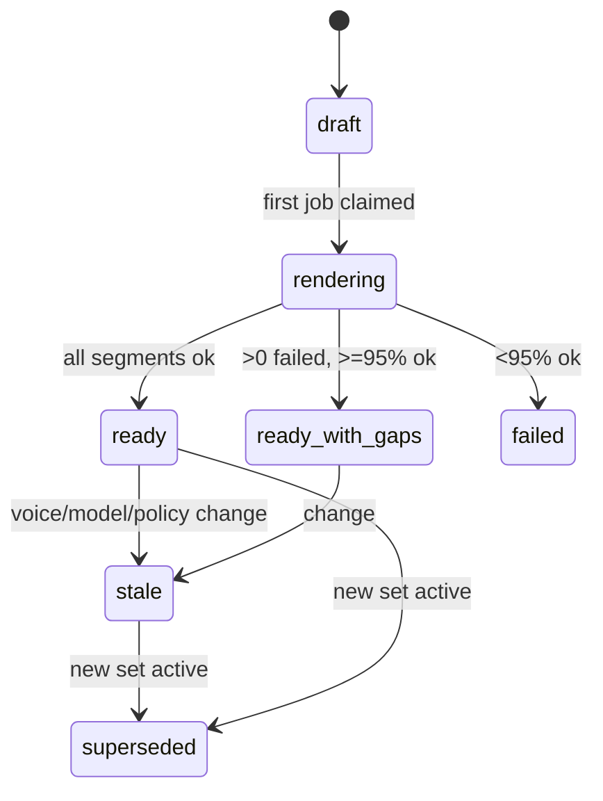
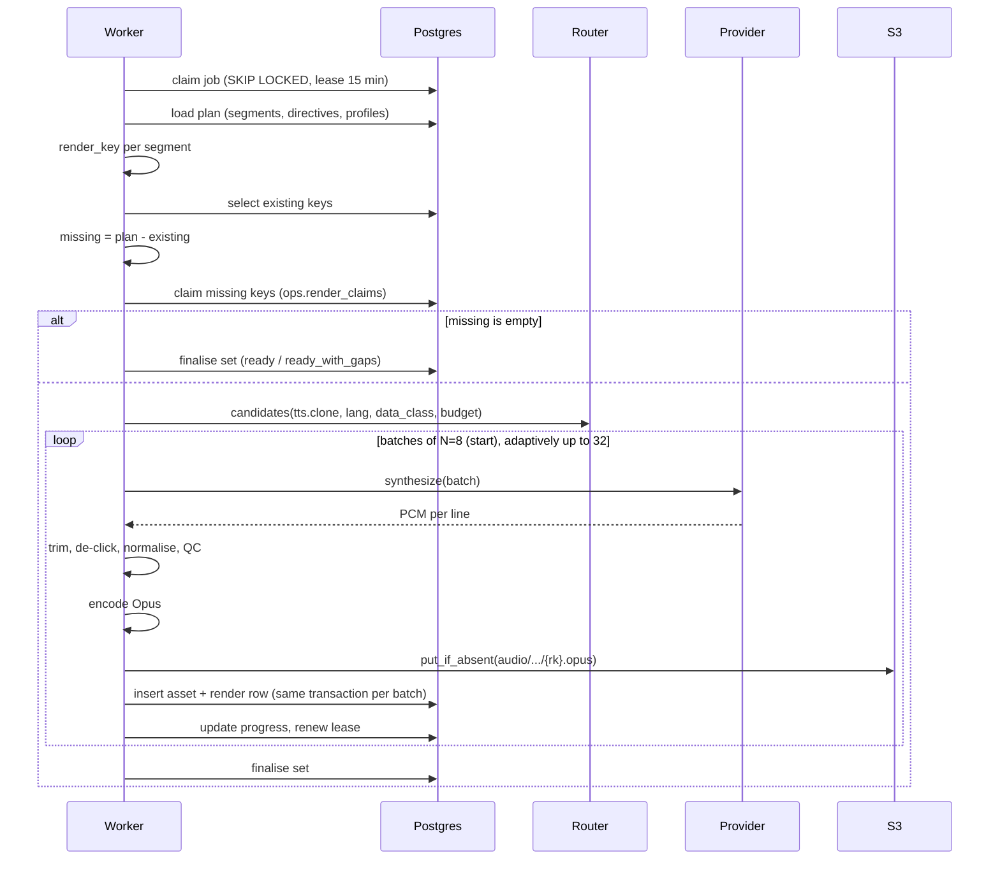
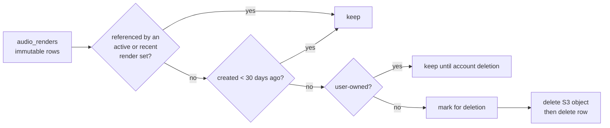

# 05. Audio and Cache

The cache is the product's unit economics. Everything in this document exists to make one
sentence true:

> For a given (text, voice identity, model weights, performance) tuple, the platform
> synthesises audio at most once, ever, and serves it to everyone entitled to hear it.

**Launch note.** The invariants below are enforced in the launch build. The storage target is
the local filesystem rather than S3: segments are content-addressed WAVs under
`media/segments/<2-char>/rk1_<hash>.wav`, masters are AAC under
`media/books/<work>/chapters/<NNN>/master.m4a`, and the "object exists before the row is
published" rule becomes "file exists and is non-empty before the row is published". Opus,
HLS and lifecycle policies are post-launch; nothing in the key or the claim protocol changes
when they arrive (ADR-0007).

## 1. Invariants

| # | Invariant | Enforced by |
|---|---|---|
| I1 | A render key is a pure function of its inputs; no clock, no user, no request id | Single key function, no ambient inputs |
| I2 | Audio bytes are immutable; an object key is never rewritten | `put_if_absent()` in the storage wrapper |
| I3 | One render key → at most one row in `audio_renders` | Primary key on `render_key` |
| I4 | A chapter is rendered from one model family | Render sets; router refuses cross-family mixing |
| I5 | Missing audio is generated once, even under concurrent demand | Unique job key + `ops.render_claims` |
| I6 | A user's action on one character invalidates only that character's segments | Key includes `spk` and voice identity, not the book |
| I7 | Shared renders are only served when rights and territory allow | `shareable` + territory predicate at query time |

Any change that weakens one of these is an ADR, not a patch.

## 2. The render key

### 2.1 Canonical form

```python
# python/aab_tts/key.py
import hashlib
import json
import unicodedata

KEY_VERSION = "rk1"

def _nfc(s: str) -> str:
    return unicodedata.normalize("NFC", s)

def _sha(s: str) -> str:
    return hashlib.sha256(_nfc(s).encode("utf-8")).hexdigest()

def canonical_bytes(payload: dict) -> bytes:
    # sorted keys, no whitespace, UTF-8, explicit nulls kept, floats forbidden
    return json.dumps(
        payload,
        sort_keys=True,
        separators=(",", ":"),
        ensure_ascii=False,
        allow_nan=False,
    ).encode("utf-8")

def render_key(
    *,
    text: str,                 # normalised segment text
    phon: str,                 # after pronunciation lexicon
    lang: str,                 # BCP-47, case-normalised
    spk: str,                  # voice identity: preset id, reference-clip sha256, or
                               # design hash — never a per-book character id
    voice: dict,               # see below
    model: dict,               # {"id","ver","w"}
    params: dict,              # integer-scaled, see below
    perf: dict,                # {"emotion","intensity","pace","style"}
    policy: str,               # tts policy version, e.g. "tts-0.4.2"
    pre: str,                  # preprocessing version, e.g. "pre-2026-11-a"
) -> str:
    payload = {
        "v": 1,
        "text": _sha(text),
        "phon": _sha(phon),
        "lang": lang.lower(),
        "spk": spk,
        "voice": voice,
        "model": model,
        "params": params,
        "perf": perf,
        "policy": policy,
        "pre": pre,
    }
    return f"{KEY_VERSION}:" + hashlib.sha256(canonical_bytes(payload)).hexdigest()
```

### 2.2 Voice block, exactly one of three shapes

```json
{"src": "reference_clone", "ref": "<sha256 of reference.wav>", "rev": 3}
{"src": "preset",          "preset_id": "qwen3-customvoice-aria"}
{"src": "designed",        "design_hash": "<sha256 of normalised design prompt>"}
```

`rev` is present for all three (it is the `voice_profiles.revision`), so an explicit,
deliberate re-clone with identical bytes still produces a new key and a new render set. This
is the escape hatch for "the voice is subtly wrong and I want a fresh draw".

### 2.3 Numbers in the key are integers

Floats serialise differently across languages and versions (`0.30000000000000004`). The key
therefore carries integers only:

| Parameter | Key field | Scale |
|---|---|---|
| temperature | `t_bp` | basis points (`0.70` → `7000`) |
| top_p | `p_bp` | basis points |
| speed | `s_pm` | permille (`1.05` → `1050`) |
| seed | `seed` | integer |
| max new tokens | `mtok` | integer |

The adapter converts back to floats at the boundary. A float in a key is a bug.

### 2.4 What is deliberately excluded

| Excluded | Why |
|---|---|
| `context_note` (free text) | Unbounded cardinality; enormous cache loss for no measurable gain |
| user id, request id, timestamp | Would make every render unique |
| chapter/scene id | Same line, same voice, same audio — reuse across books is a feature |
| full persona prose | Changes cosmetically without changing audio; `ref` already pins identity |
| output format | Applied after generation, not part of it |
| provider id | Same model weights on a different host must hit the same key |

### 2.5 Test vectors

Three golden tests, in `evals/tts/test_render_key.py`:

1. **Stability** — a fixture payload produces a fixed literal key. Catches accidental
   serialisation changes.
2. **Sensitivity** — mutating any single leaf field changes the key. Parameterised over every
   field; a new field with no test is caught by a coverage assertion on `PAYLOAD_FIELDS`.
3. **Equivalence** — reordered dicts, different whitespace, and NFD vs NFC text produce the
   same key.

A key change without a `rk2:` bump and a migration plan is a data-corruption event.

## 3. Render sets

A `chapter_render_set` is the unit of coherence. It binds: chapter revision, model family,
policy version, and the voice assignments used.



Rules:

- Exactly one active set per `(chapter, scope, owner)` — enforced by a partial unique index.
- A set is **never** partially replaced from a different model family. New model → new set.
- `ready_with_gaps` is playable: the player renders a short tone-free gap and shows "line
  unavailable" only on request. One bad line must not block a chapter.
- Going `stale` is explicit (triggered by a voice swap, lexicon change, or policy bump) and
  does not delete audio; it only stops the set being served.

### 3.1 What a voice swap actually costs

| Action | Segments invalidated |
|---|---|
| Change character X's voice profile | all segments where `spk = X` in that book (typically 4–15% of a chapter) |
| Change narrator voice | all narration segments (~55–70%) |
| Change one line's emotion | that line |
| Change pronunciation of a name | all segments where `phon` changes |
| Change model family | everything (new render set) |
| Change mastering policy (e.g. LUFS target) | all chapter masters, but **no** segment renders — mastering is downstream of the key |

The last row is why mastering settings are *not* in the render key: re-mastering is cheap
(CPU seconds), re-synthesising is not.

## 4. Segmentation for TTS

Segmentation is deterministic and provider-independent. It runs after story analysis, not
inside the TTS call.

| Rule | Value | Rationale |
|---|---|---|
| Target length | 60–200 chars | Natural prosody; predictable latency |
| Hard max | 480 chars (model capability) | Beyond this, models truncate or drift |
| Split points | sentence end → clause comma → word | Prefer meaning-preserving boundaries |
| Never split | inside a quotation unless > 480 chars | A dialogue line split mid-sentence breaks performance |
| Merge | consecutive narration blocks by the same speaker with no paragraph break | Fewer calls, better prosody |
| Gap | `gap_after_ms` 120 default, 600 at scene break, 1200 at chapter break | Pacing is a property of the plan, not the audio |
| Language switch | split at the boundary, tag each line | Multilingual books are segmented per language |

Each segment gets: stable id (`sg_`), `ordinal` within chapter, `char_count`, `text_hash`,
`phon_hash`, `speaker_kind`, `character_id`, `gap_after_ms`. Ids are derived from
`(chapter_id, ordinal)` so re-running segmentation on unchanged text is a no-op.

## 5. Generation: idempotent by construction

### 5.1 Resolve what is missing

```sql
-- 1. Compute candidates in the worker (pure code), then ask which already exist.
select render_key, asset_id
  from shared.audio_renders
 where render_key = any($1::text[]);
```

```sql
-- 2. Claim the keys that do not exist. A claim is a short lease, not a row that pretends
--    audio exists: shared.audio_renders is only ever written after the object is in S3.
insert into ops.render_claims (render_key, job_id, expires_at)
select unnest($1::text[]), $2, now() + interval '20 minutes'
on conflict (render_key) do nothing
returning render_key;

-- 2b. Steal claims whose owner died. A second statement, so the common case takes no lock.
update ops.render_claims
   set job_id = $2, claimed_at = now(), expires_at = now() + interval '20 minutes'
 where render_key = any($1::text[])
   and expires_at < now()
returning render_key;
```

```sql
-- 3. One job per chapter render set. Unique idempotency key makes this a no-op if it exists.
insert into ops.jobs (job_id, kind, target_type, target_id, priority, state,
       idempotency_key, config_version)
values ($1, 'tts.chapter', 'chapter_render_set', $2, $3, 'queued', $4, $5)
on conflict (idempotency_key) do nothing
returning job_id;

-- 4. After the object is in S3: publish the render and release the claim, same transaction.
insert into shared.audio_renders (...) values (...);
delete from ops.render_claims where render_key = any($1::text[]);
```

Why a separate claim table rather than reserving a row in `audio_renders`: the invariant
"every render row points at an object that exists" is worth more than saving a table. A claim
carries no audio, can expire, and its worst failure is a wasted GPU call, not a dangling
reference. The chapter-level idempotency key already prevents the common duplicate; claims
cover the rarer case of two *different* books containing the same line and voice.

`idempotency_key = 'tts.chapter:' || render_set_id`. A second "request chapter" from a second
user, or the prefetcher, or the curation run, all collapse onto the same job.

### 5.2 Execute



Per-batch transactions, not per-chapter. A chapter has 200–600 segments; one transaction
holding 600 rows and 600 S3 writes for 8 minutes is how a database gets a bad reputation. If
the worker dies, completed batches are already durable and the retry skips them via
`render_key`.

### 5.3 Ordering within a chapter

Segments are rendered in **narrative order**, not by speaker. Reason: the first audio the
user hears must be the first audio of the chapter. Grouping by speaker would batch more
efficiently but deliver a chapter that is unlistenable until 100% complete.

Batching therefore uses a *window*: take the next 32 missing segments in ordinal order, group
the window by `(voice_profile, model)` and emit sub-batches that preserve order in the
reassembly. Practically this yields 2–3 sub-batches per window for a normal chapter, which is
close enough to speaker-grouped efficiency and far better for perceived latency.

### 5.4 Preview path

If `preview_first` is set (uploads and long-tail requests), the worker renders the first
~60 s (first 6–10 segments) and commits it, then continues. The API returns 200 with a partial
manifest whose `complete: false` tells the player to keep polling. Time-to-first-audio for an
uncached chapter is therefore bounded by one batch, not one chapter.

## 6. Quality control

QC runs on every segment, and on the assembled chapter. A segment that fails is retried with
a bumped seed (which changes the key); two failures mark it as a gap.

| Check | Method | Pass | Action on fail |
|---|---|---|---|
| Non-empty, decodable | `ffprobe` | duration > 0.2 s | retry once, then gap |
| Duration sane | expected chars ÷ speaking rate | 0.4×–2.5× expected | retry, then flag |
| Silence ratio | `silencedetect` at −45 dB, > 0.4 s | < 25% of duration | retry |
| Clipping | `astats` peak | < 0.1% samples at full scale | retry with −1 dB gain |
| Loudness | `ebur128` after normalise | −19 ± 0.5 LUFS, TP ≤ −3 dBTP | re-normalise (no re-synthesis) |
| ASR round-trip | faster-whisper small, WER | WER ≤ 0.15 (proper nouns excluded via lexicon) | flag for review, keep audio |
| Speaker drift | embedding cosine to reference | ≥ 0.70 per segment | retry with new seed |
| Duplicate/last-segment repeat | hash + duration compare with previous | not identical | retry (classic autoregressive loop) |

The last check catches the most common catastrophic TTS failure — a model that repeats the
final phrase until `max_new_tokens`. It is cheap and it is the difference between "AI
narration" and "obviously broken AI narration".

QC results are stored per render (`qc_status`, plus a `qc` JSONB detail), never discarded:
a review queue is built from them.

### 6.1 Why ASR round-trip is not a hard gate

ASR introduces its own errors on proper nouns and archaic syntax. Treating it as a hard gate
would reject good audio. It is a *ranking signal* for the review queue, and a hard gate only
on `WER > 0.4`, which reliably indicates real corruption.

## 7. Mastering

Segments are the cache unit; chapters are the listening unit. Mastering concatenates and
normalises, and is deliberately outside the render key so it can be re-run cheaply.

```bash
# 1. Build the concat list with explicit silence between segments.
#    Silence length comes from gap_after_ms; scene/chapter breaks are longer.
#    Written as a filter_complex so no temporary WAVs are created.
ffmpeg -f concat -safe 0 -i list.txt \
  -af "highpass=f=60,lowpass=f=11000" \
  -ar 24000 -ac 1 -c:a pcm_s16le chapter_raw.wav

# 2. Two-pass loudness normalisation: measure, then apply.
ffmpeg -i chapter_raw.wav -af ebur128=peak=true -f null - 2> measure.log
ffmpeg -i chapter_raw.wav \
  -af "loudnorm=I=-19:TP=-3:LRA=11:measured_I=<I>:measured_TP=<TP>:measured_LRA=<LRA> \
       :measured_thresh=<thresh>:offset=<offset>:linear=true" \
  -ar 24000 -ac 1 chapter_master.wav

# 3. Deliverable encode.
ffmpeg -i chapter_master.wav -c:a aac -b:a 64k -ar 24000 -ac 1 \
  -movflags +faststart chapter_master.m4a
```

Details that matter:

- **`linear=true`** keeps the loudness adjustment as a single gain where possible, preserving
  dynamics. Falling back to dynamic mode is recorded in the manifest because it audibly
  changes the result.
- **Highpass at 60 Hz** removes the rumble most TTS models leave below the speaking band;
  **lowpass at 11 kHz** is just below Nyquist for 24 kHz and removes codec-hostile fizz.
- **−19 LUFS** rather than the podcast-standard −16: audiobooks are long-form and listeners
  routinely raise volume; −19 leaves headroom and is the Audible-ish convention.
- **Deterministic**: same inputs, same ffmpeg build, same output. The ffmpeg version is part
  of `policy`, which is recorded on the asset, not in the render key.

### 7.1 Delivery formats

| Artefact | Codec | Rate | Size/hour | Use |
|---|---|---|---|---|
| Segment | Opus in Ogg | 48 kbps mono | 21.6 MB | cache unit, HLS parts |
| Chapter master | AAC-LC | 64 kbps mono | 28.8 MB | progressive download, export source |
| Chapter HLS | Opus/AAC | 48/64 | ~24 MB | adaptive streaming |
| M4B export | AAC-LC | 64 kbps | 28.8 MB | one file with chapter markers, on demand |

Opus at 48 kbps mono is transparent for speech at 24 kHz; AAC is retained for the export path
because M4B chapter markers and broad player support matter more than the last 25% of bytes.

### 7.2 Chapter manifest

```json
{
  "render_set_id": "rs_7c1",
  "chapter_id": "ch_003",
  "revision_id": "rev_01JB8Z1A",
  "duration_ms": 1184000,
  "complete": true,
  "loudness_lufs": -19.0,
  "true_peak_dbtp": -3.1,
  "segments": [
    {"ordinal": 0, "segment_id": "sg_01JBA0F1", "start_ms": 0, "duration_ms": 4120,
     "url": "audio/model/9f/rk1:9f2c...opus", "gap_after_ms": 120},
    {"ordinal": 1, "segment_id": "sg_01JBA0F7", "start_ms": 4240, "duration_ms": 2870,
     "url": "audio/model/9f/rk1:5c1f...opus", "gap_after_ms": 120}
  ],
  "master_url": "audio/chapters/rs_7c1/ch_003/master.m4a",
  "hls_url": "audio/chapters/rs_7c1/ch_003/manifest.m3u8"
}
```

Two playback strategies, one manifest:

- **Seeking within the chapter** uses the master file and `start_ms` offsets.
- **Starting mid-book** fetches only the needed segments plus the next few, so a listener who
  jumps to chapter 12 in a 40-hour book does not download 300 MB.

## 8. Prefetch

```python
def should_prefetch(chapter, position_ms, user) -> bool:
    frac = position_ms / max(chapter.duration_ms, 1)
    if frac >= 0.55:                      # most of the chapter consumed
        return True
    if chapter.duration_ms - position_ms <= 120_000:   # 2 minutes left
        return True
    return False
```

Depth:

| Caller | Lookahead | Priority |
|---|---|---|
| User listening (interactive) | 1 chapter | `user_waiting` (10) |
| Prefetch after 55% | 2 chapters, capped by user's historical completion | `prefetch` (50) |
| Curation batch | next chapter of current title only | `curation` (200) |

Guards:

- Prefetch is suppressed when `user_waiting` depth > 20, so the tail cannot starve the head.
- Prefetch is suppressed for a user who has abandoned 3 of the last 5 books — spend follows
  intent.
- Prefetch jobs are cancelled (not failed) if the user stops listening and the set is not
  within N chapters of their position after 24 h.

## 9. Concurrency

Three levels, each with a reason:

| Level | Limit | Why |
|---|---|---|
| Per provider | `provider.max_concurrency` from registry | Providers enforce their own caps; exceeding them wastes retries |
| Per worker process | `WORKER_TTS_CONCURRENCY` (default 4) | Keeps CPU bound to audio post-processing, not blocked on sockets |
| Global GPU | `gpu.max_concurrency` (default 8 at MVP) | Bounds spend rate and queue latency; the only number tied to the invoice |

Implementation: `asyncio.Semaphore` per provider instance, created at process start from the
registry, refreshed on config version change. No distributed lock: the provider's own 429 plus
the router's retry policy is the distributed backpressure.

Rate-limit arithmetic that is easy to get wrong: at RTF 0.25, one L4 handles 4 audio hours per
GPU hour, i.e. roughly 24 audio hours/day at 100% utilisation. A 200-title curation run of
10 hours each is 2,000 GPU-hours — this is why curation is budgeted and incremental, not a
one-off backfill.

## 10. Invalidation

| Change | Segment renders | Chapter master | Render set | User impact |
|---|---|---|---|---|
| Text correction (revision bump) | affected segments only | affected chapters | new revision, sets remapped | none for other chapters |
| Speaker correction | that segment | that chapter | set stays | none |
| Emotion correction | that segment | that chapter | set stays | none |
| Voice profile revision bump | that character's segments | those chapters | new set | re-render cost, visible ETA |
| Pronunciation lexicon change | segments whose `phon_hash` changed | those chapters | set stays | none |
| TTS policy / ffmpeg version | none | all chapters | new set | CPU-only cost |
| Model weights change | everything | everything | new set | full re-render |
| Rights change (shareable → false) | none | none | none | sharing stops immediately |

Rights changes never touch audio. They change a predicate. This is why `shareable` lives on
the render row and the work, and is checked at request time rather than baked into the CDN
path.

## 11. Garbage collection and retention



Rules:

- The **row is the reference count**. An S3 listing is never the source of truth; a lifecycle
  rule on the bucket is a backstop against orphaned objects, not the mechanism.
- 30-day grace covers a user toggling a voice back, and covers rollback of a bad curation run.
- Deletion is by batch with a manifest written to `ops` before the S3 delete, so an
  interrupted GC can resume.
- Superseded chapter masters and exports expire at 30 days via lifecycle; segment audio is
  only deleted by the GC job, never by lifecycle, because segments are shared across chapters
  and books.

Storage economics at 100 catalogue titles × 10 h:

```
segments   : 1000 h × 21.6 MB/h ≈ 21.6 GB
masters    : 1000 h × 28.8 MB/h ≈ 28.8 GB
sources/text: < 1 GB
total      ≈ 52 GB × $0.023/GB ≈ $1.20/month
```

At that price, deleting audio aggressively is false economy; the GC exists to keep the
reference graph honest, not to save dollars.

## 12. Cost model of a chapter

Worked example, 30-minute chapter ≈ 25,000 characters, 260 segments:

| Item | Quantity | Unit cost | Cost |
|---|---|---|---|
| TTS GPU @ RTF 0.25 | 450 s | $0.80/h | $0.10 |
| QC (ASR on 10% of segments) | 26 × 10 s CPU | negligible | $0.002 |
| Mastering (ffmpeg) | ~15 s CPU | negligible | $0.001 |
| Storage | 14.4 MB | $0.023/GB-mo | $0.00003/mo |
| **Marginal cost, first render** | | | **≈ $0.10** |
| Marginal cost, subsequent listens | CDN bytes | $0.085/GB | $0.0012 |

The ratio is the point: the first listener pays ~$0.10, the hundredth pays a tenth of a cent.
Every design choice above exists to make the second row true.

## 13. Failure behaviour

| Situation | State | Recovery |
|---|---|---|
| Worker dies mid-chapter | leased job expires in 15 min | requeue; completed batches skipped by `render_key` |
| Provider 5xx mid-batch | batch not committed | retry batch on next candidate; no partial rows |
| S3 put fails | asset not committed | retry; identical key makes the retry safe |
| DB commit fails after S3 put | orphan object | GC sweep finds it; harmless |
| One segment persistently fails | `ready_with_gaps` | line-level "fix this" action |
| < 95% of segments OK | `failed` | surfaced to user with retry button; other chapters unaffected |
| Mastering fails | segments remain valid | master retried without touching renders |
| Budget exhausted | job `queued` (paused) | resumes when budget resets or is raised |

The general principle: **audio is never lost, only unreferenced**. S3 is written before the DB
row, and the DB row is never written for an object that does not exist.

## 14. Testing

| Test | Kind | Asserts |
|---|---|---|
| Golden render keys | unit | fixed fixtures → fixed literals |
| Key sensitivity | property | every payload field mutation changes the key |
| Key equivalence | property | key-order, whitespace, NFC/NFD invariance |
| Idempotent enqueue | integration | 100 concurrent requests → 1 job, 1 render per key |
| Cache reuse across books | integration | identical line in two books → 1 object |
| Voice swap blast radius | integration | swapping character X changes only X's keys |
| QC gates | unit, fixtures | each failure fixture is caught, each good fixture passes |
| Mastering determinism | golden | same inputs + ffmpeg version → identical output hash |
| Manifest correctness | integration | segment offsets sum to duration ± tolerance |
| GC safety | integration | referenced objects never deleted; orphans are |
