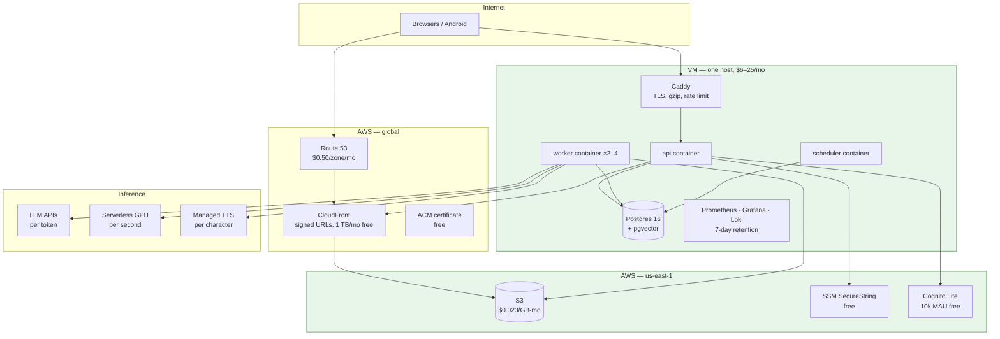

# 07. Infrastructure and Cost

## 0. Launch profile — $0 per month

The launch runs entirely on hardware that already exists, with no account, no card and no
expiring credit (ADR-0007). Every choice below is implemented and exercised end to end.

| Concern | Launch implementation | New cash cost |
|---|---|---|
| Compute | the operator's existing Linux machine (development run: 12 cores, 15 GB RAM) | $0 |
| Database | one SQLite file under `AAB_HOME` | $0 |
| Media | local disk, content-addressed WAVs + AAC masters + JSON manifests | $0 |
| Speech | Kokoro-82M int8 ONNX on CPU, Apache-2.0, 89 MB + 27 MB voice bank | $0 |
| Story intelligence | deterministic rules in `aab_story` | $0 |
| Identity | optional shared `AAB_ADMIN_TOKEN` | $0 |
| Delivery | FastAPI with HTTP range support | $0 |
| Observability | structured logs to stderr; queue depth in `/api/health` | $0 |
| CI | local `pytest` + `scripts/smoke.sh` | $0 |

**Cash cost: $0.** This is not a free tier: nothing expires and no billing relationship
exists. The machine, its electricity and its internet connection are real costs, but they are
not *new* spend, and this document does not price them because they depend on where the
machine already lives. Any claim of "free compute" beyond that would be dishonest.

Measured footprint from the verification run:

- 2 chapters, 53 s of audio, 2.8 MB on disk.
- Launch keeps 24 kHz 16-bit mono PCM for segments (≈173 MB per audio hour) plus AAC masters
  (≈29 MB per audio hour), so budget **≈200 MB per rendered audio hour**. This is higher
  than the 50 MB/hour figure in §5, which assumes Opus segment storage in the paid profile.
- A 10-hour novel therefore needs about 2 GB. Plan disk before catalogue size.

The quality limits are explicit: CPU-only synthesis, Kokoro's preset voices (no cloning),
rule-based attribution, single-writer concurrency, and no replica or CDN. Those are the
prices paid for $0, and §7's paid scenarios are the purchase order for removing them.

## 1. Topology (target, after the first paid opt-in)



Three deliberate structural choices:

1. **Audio never traverses the host.** S3 → CloudFront → client. The host would otherwise pay
   for egress twice (once from S3, once to the user) and would become the bottleneck.
2. **No VPC on the host.** The VM is a plain internet host with a firewall. Putting it in a
   VPC would require a NAT Gateway (~$32/month) to reach provider APIs — one component that
   costs more than everything else combined.
3. **No GPU fleet.** All inference is metered per call or per second.

## 2. Host sizing

| Tier | Spec | Monthly | Handles | Upgrade trigger |
|---|---|---|---|---|
| `dev` | 2 vCPU / 4 GB / 80 GB | ~$6 | local dev, CI, staging | — |
| `mvp` | 4 vCPU / 8 GB / 160 GB | ~$14 | 1,000 MAU, 8 concurrent jobs | p95 API > 500 ms |
| `growth` | 8 vCPU / 16 GB / 320 GB | ~$28 | 5,000 MAU, 20 concurrent jobs | CPU > 70% sustained |
| `split` | API host + worker host | ~$56 | 20,000 MAU | worker CPU starves API |

Prices are **planning assumptions** for a commodity European/US VPS (Hetzner, Vultr,
DigitalOcean class). Confirm at provisioning; they move. The architecture does not depend on
any specific vendor — it needs a Linux box with Docker and a public IP.

Disk sizing: Postgres (small, < 10 GB even at 100k books), 30 GB of transient audio workspace,
20 GB OS and containers, plus headroom. Audio working space is the real driver: one chapter
render holds ~300 MB of PCM while mastering, and 8 concurrent chapters need 2.5 GB.

Memory: Postgres 2 GB shared buffers, 4 workers × 400 MB, API 600 MB, observability 1 GB.
8 GB is the first comfortable size.

## 3. Verified prices

Recorded 2026-11-17. Every entry is either *verified* (vendor pricing page at that date) or
*assumption*. The table is the input to the cost model; the model is in §7.

| Service | Price | Status |
|---|---|---|
| S3 Standard storage | $0.023/GB-month | verified |
| S3 PUT | $0.005 per 1,000 | verified |
| S3 GET | $0.0004 per 1,000 | verified |
| S3 → CloudFront transfer | $0.00 | verified (AWS does not charge origin fetch from S3) |
| CloudFront transfer to internet | 1 TB/month free, then $0.085/GB | verified |
| CloudFront requests | 10 M/month free, then ~$0.0075/10k HTTPS | verified |
| CloudFront flat-rate Pro plan | $15/month for 50 TB | verified (worth it above ~1.2 TB/mo) |
| Cognito Lite (essentials) | 10,000 MAU free, then $0.0055/MAU | verified |
| Route 53 hosted zone | $0.50/month | verified |
| ACM certificate | free | verified |
| SSM Parameter Store (standard) | free | verified |
| SES | $0.10 per 1,000 emails | verified |
| AWS Budgets | free (2 budgets), $0.02/day after | verified |
| Lambda | 1 M requests + 400k GB-s/month always free | verified (unused at MVP) |
| RunPod serverless, 24 GB | $0.75/hour | verified |
| Modal L4 | $0.80/hour | verified |
| Google Chirp 3 HD | $30 per 1 M characters | verified |
| ElevenLabs | $40–80 per 1 M characters | verified |
| DeepSeek V4.1 Flash (off-peak) | $0.15 in / $0.60 out per 1 M tokens | verified |
| Domain registration | ~$10–15/year | assumption |

### 3.1 The AWS Free Tier is not a plan

Since July 2025 new AWS accounts receive **$100 plus up to $100 in credits, valid for six
months**, after which the account is **closed unless upgraded to paid**. Existing accounts are
ineligible.

This is precisely why the launch does not use AWS at all. The terms make it a trial with a
card attached, not a zero-cost platform, and the directive is a $0 launch with no accounts
(ADR-0007). The notes below apply only when AWS is adopted as a deliberate opt-in.

Consequences for this project:

- Do not architect around free credits. The durable allowances are the *always-free* ones:
  CloudFront 1 TB + 10 M requests/month, Cognito 10 k MAU, Lambda 1 M requests.
- Use a **dedicated new AWS account** for this project, not the team's existing account —
  otherwise the credits are forfeited and the six-month clock does not exist.
- Calendar the upgrade for **day 150**. An account closing with the production S3 bucket in it
  is a data-loss incident with a predictable date.
- At our scale the paid cost of S3 + CloudFront + Cognito is **$0–5/month** for the first year
  anyway. The credits are a convenience, not a strategy.

## 4. Service selection, with the rejected option named (target choices)

At launch every row below is replaced by a local equivalent (§0). The choices here are the
first paid tier, kept because they are cheaper than the alternatives at the same capability.

| Need | Choice | Rejected | Why |
|---|---|---|---|
| Compute | one VPS + Docker | ECS Fargate + ALB | ~$36/mo fixed for less control |
| Database | self-managed Postgres on the host | RDS / Aurora Serverless v2 | ~$15/mo, ~$43/mo respectively, both with a floor |
| Object storage | S3 | MinIO on the host | S3 is $1–25/mo at this scale; local disks are a backup liability |
| CDN | CloudFront | Cloudflare (free) | CloudFront is free to 1 TB and integrates with signed URLs + S3; Cloudflare is the fallback if we ever leave AWS |
| Identity | Cognito Lite | Auth0, Clerk, self-hosted Keycloak | 10 k MAU free, then $0.0055 — cheapest to first revenue |
| Queue | Postgres `SKIP LOCKED` | SQS, Kafka | transactional enqueue, zero cost, adequate to ~5k jobs/s |
| Secrets | SSM SecureString | Vault | free, already in AWS, no HA to run |
| Metrics/logs | Prometheus + Loki on the host | CloudWatch | CloudWatch log ingestion (~$0.50/GB) dwarfs the host bill |
| Errors | Sentry free tier | self-hosted | 5k events/mo free, best signal per dollar |
| CI | GitHub Actions | self-hosted runners | 2,000 min/mo free is enough for a repo this size |
| Email | SES | Postmark | $0.10/1k; transactional volume is tiny |

### 4.1 Cost traps we are explicitly avoiding

| Trap | Monthly cost | Mitigation |
|---|---|---|
| NAT Gateway for a VPC-hosted worker | $32 + $0.045/GB | host outside a VPC |
| CloudWatch Logs ingestion at debug level | $20–100 | logs to disk, ship errors only, 7-day retention |
| ALB even when "it's just one service" | $16 + LCU | Caddy on the host |
| Idle GPU instance | $180–400 | serverless only |
| Egress through the API host | doubles bandwidth | audio only via CloudFront/S3 |
| Small-object GET storms for segments | request charges + latency | chapter master for sequential play, manifest for seeking |
| Managed TTS as the default by accident | 10× unit cost | alerts on provider mix; managed is a flagged fallback |
| Cross-region reads | $0.02/GB | host in the same region as S3, or accept ~$0.09/GB for the small re-mastering reads |

## 5. Storage and bandwidth

One audio hour: 21.6 MB of segment audio (Opus 48 kbps) + 28.8 MB of chapter master
(AAC 64 kbps) ≈ **50 MB** for a fully rendered hour, plus ~10 MB of sources and text per book.

```
book_storage(10 h)        ≈ 500 MB + 10 MB       ≈ 0.5 GB
catalogue_100_titles      ≈ 50 GB                ≈ $1.15/mo
catalogue_1,000_titles    ≈ 500 GB               ≈ $11.50/mo
```

Bandwidth:

```
listening_hours × 28.8 MB  = egress
8,000 h/mo (1,000 MAU)     = 230 GB   → free (CloudFront 1 TB)
80,000 h/mo (10,000 MAU)   = 2.3 TB   → 1.3 TB billable = $110, or $15 flat plan
```

The flat-rate plan is the single best lever above 1 TB: at 10k MAU it turns $110 of egress
into $15. It is also a commitment, so the trigger is measured, not assumed.

## 6. Inference cost model

Inference cost is driven by **new audio hours**, not by users. That is the entire point of the
shared cache.

```
monthly_inference =
      new_audio_hours × tts_cost_per_hour
    + new_books       × llm_cost_per_book
    + qc_overhead     (≈ 20% of the TTS line)
```

### 6.1 Per-unit costs

| Component | Low | High | Basis |
|---|---|---|---|
| TTS, self-hosted 1.7B | $0.12/audio h | $0.28/audio h | RTF 0.15–0.35 × $0.80/GPU h *(assumption — Phase 0 gate)* |
| TTS, self-hosted 0.6B | $0.06/audio h | $0.15/audio h | RTF 0.08–0.20 *(assumption)* |
| QC + mastering (CPU) | $0.002/audio h | $0.01/audio h | measured from ffmpeg wall time |
| LLM, chapter analysis | $0.10/book | $0.50/book | 125k in / 40k out tokens + retries *(assumption)* |
| LLM, consolidation | $0.02/book | $0.05/book | digests only |
| Managed TTS fallback | $0.80/audio h | $4.00/audio h | Polly Neural / Chirp 3 / ElevenLabs |

### 6.2 New audio hours per month

| Source | 100 MAU | 1,000 MAU | 10,000 MAU |
|---|---|---|---|
| Catalogue expansion (shared, pre-generated) | 50 h | 150 h | 400 h |
| User uploads (private) | 30 h | 200 h | 800 h |
| Re-renders (voice changes, corrections) | 20 h | 50 h | 300 h |
| **Total** | **100 h** | **400 h** | **1,500 h** |

Uploads are the only line that scales linearly with users, which is why the default quota is
**5 audio hours of new generation per user per month** and why uploads are queued at
`user_waiting` priority with an honest ETA.

## 7. Three scenarios (paid opt-in path)

These are **not launch costs**. They describe the first paid step — a host, object storage,
identity and GPU inference — and exist so that opt-in decisions are priced before they are
taken. The launch figure is §0: $0.

All figures monthly, USD, steady state after launch. The launch-month one-off is called out
separately because it is the number that surprises people.

### 7.1 Staging host (first paid step, before public traffic)

| Item | Cost |
|---|---|
| Host (2 vCPU/4 GB) | $6 |
| Domain | $1 |
| S3 (< 5 GB) | $0.12 |
| CloudFront | $0 |
| Cognito | $0 |
| Route 53 | $0.50 |
| Observability | $0 |
| **Total** | **≈ $8** |
| One-off: benchmark GPU (10 h) | $8 |

### 7.2 First paid month — 100 MAU, 200-title catalogue

> This is **not** the $0 launch. The $0 launch has no catalogue pre-generation, no host bill
> and no inference bill; a listener waits for the chapter they asked for. The figures below
> apply only after deliberately enabling paid inference and pre-generation.

| Item | Cost |
|---|---|
| Host (4 vCPU/8 GB) | $14 |
| S3 (≈ 100 GB) | $2.30 |
| CloudFront (23 GB egress) | $0 |
| Cognito (100 MAU) | $0 |
| Route 53 + domain + SES | $1.60 |
| TTS, 100 new audio h × $0.20 | $20 |
| QC overhead (20%) | $4 |
| LLM, 10 new books × $0.30 | $3 |
| **Monthly total** | **≈ $45** |

Cost per listening hour at 800 h/month: **$0.056** — dominated by fixed infrastructure, which
is the correct shape at this scale.

### 7.3 Growth — 1,000 MAU

| Item | Cost |
|---|---|
| Host (8 vCPU/16 GB) | $28 |
| S3 (≈ 400 GB) | $9.20 |
| CloudFront (230 GB) | $0 |
| Cognito (1,000 MAU) | $0 |
| TTS, 400 h × $0.20 | $80 |
| QC overhead | $16 |
| LLM, 40 books × $0.30 | $12 |
| Observability + email + domain | $6 |
| **Monthly total** | **≈ $151** |

Cost per listening hour at 8,000 h: **$0.019**.

### 7.4 Scale — 10,000 MAU

| Item | Cost |
|---|---|
| Host (2 × 8 vCPU/16 GB: API + worker) | $56 |
| S3 (≈ 1.1 TB) | $25 |
| CloudFront (2.3 TB, Pro flat plan) | $15 |
| Cognito (10,000 MAU, at the free-tier edge) | $0 |
| TTS, 1,500 h × $0.20 | $300 |
| QC overhead | $60 |
| LLM, 150 books × $0.30 | $45 |
| Observability + email + domain + Sentry | $12 |
| **Monthly total** | **≈ $513** |

Cost per listening hour at 80,000 h: **$0.0064**.

### 7.5 What the cache is worth

If every listening hour were generated for the listener who requested it:

```
80,000 h × $0.20 = $16,000/month
```

The architecture costs $513. The difference — a **31× multiplier** — is not a cost
optimisation; it is the business model. Every design decision in specs 03–05 protects it, and
the single most dangerous regression is anything that makes render keys unique per user.

## 8. Sensitivity

The model is most sensitive to three numbers, in this order:

| Variable | Range | Effect at 10k MAU |
|---|---|---|
| TTS cost per audio hour | $0.12 → $0.28 | $300 → $480 (+$180) |
| New audio hours per month | 1,000 → 2,500 | $200 → $500 (+$300) |
| Managed fallback share | 0% → 10% | $0 → ~$150 |

Everything else is noise. This is why:

- the Phase 0 benchmark measures RTF before anything else,
- quotas exist on uploads,
- and the provider-mix alert exists (a routing bug that silently sends 10% of traffic to
  Chirp 3 HD costs more than the entire infrastructure).

## 9. Cost controls

| Control | Where | Effect |
|---|---|---|
| Global monthly cap | `ops.budgets` | generation pauses at 100%; playback unaffected |
| Per-provider cap | `ops.budgets` | router skips the provider |
| Per-user quota | derived from plan | 5 new audio hours/month default |
| Per-book cap | 2× estimate | prevents a runaway retry loop |
| Kill switch | `cache_only` | all provider calls stop in ≤ 5 s |
| Curation window budget | per run | pre-generation cannot overspend in one night |
| Price-change detection | nightly probe | a provider price update surfaces in 24 h |
| Provider-mix alert | metrics | > 5% of TTS minutes on a managed provider pages someone |

## 10. Backups and disaster recovery

| Item | Method | RPO | RTO |
|---|---|---|---|
| Postgres | WAL-G: nightly base backup + continuous WAL to S3 | ≤ 5 min | 30 min |
| S3 audio | versioning off (immutable), cross-region replication **not** enabled | — | rebuildable from keys |
| Config/SSM | Terraform state in S3 + versioned parameters | — | minutes |
| Secrets | SSM SecureString, exported to a sealed offline copy quarterly | — | minutes |

Why no cross-region replication at MVP: the audio is regenerable from the render keys and the
text, at a cost of roughly $0.20 per audio hour. Replicating 1 TB across regions costs
~$20/month forever to avoid a one-time rebuild. The *database* is the irreplaceable part, and
it is under 10 GB — it gets the replication attention.

Restore drill: monthly, restore the latest base backup into a scratch database and run the
smoke test suite. A backup that has never been restored is a hope.

## 11. Capacity

Measured limits to watch, with the response:

| Signal | MVP limit | Response |
|---|---|---|
| API p95 | > 500 ms | move API to its own host |
| Concurrent TTS jobs | > 20 | raise GPU concurrency (spend) or queue depth alerts |
| Queue depth `user_waiting` | > 20 | page; pause curation |
| Disk | > 80% | GC, expand volume |
| Postgres connections | > 80 | add PgBouncer |
| Write throughput | > 1,000/s | revisit ADR-0001 |

The honest statement: **this design comfortably serves 10,000 monthly listeners and
uncomfortably serves 100,000.** At 100k MAU the fixed costs move to ~$400/month (multiple
hosts, managed Postgres, possibly a second region) and the inference cost dominates anyway.
That is the right time to revisit the infrastructure decisions, not before.

## 12. Monthly operating checklist

1. Re-verify prices for every enabled provider; add `price_schedule` entries if changed.
2. Review spend vs budget; check per-book outliers > 2× estimate.
3. Check cache hit ratio trend; investigate a drop > 5 points.
4. Review dead-letter jobs by error code.
5. Confirm backups ran; run the restore drill on the first of the month.
6. Review storage growth and GC deletions.
7. Check certificate and domain expiry (automated, but verify the automation).
8. Rotate any credential older than 90 days.
9. Review failed QC categories; promote recurring failures into tests.
10. Re-run the cost model with last month's actuals and update §7 if it moved > 15%.
