# 10. Directory map and runtime flows

This is the **as-built** map of the $0 launch system: where each directory sits in the call
graph, and every flow that a request, job, file or build takes through it. Spec
[02](02-system-architecture.md) describes the *target* architecture (Postgres, S3, Cognito,
paid inference); this document describes the code that runs today. Where the two differ,
ADR-0007 is the decision record.

Diagrams are Mermaid. Node labels name real directories, modules, routes or tables so the chart
can be used as a navigation index.

## 0. One-screen overview

This is the **map of maps**. It deliberately hides implementation detail so the whole system fits
on one screen. Follow the section numbers in each node to the detailed diagram below; the
[flow index](#28-flow-index) is the text-only version of the same map.

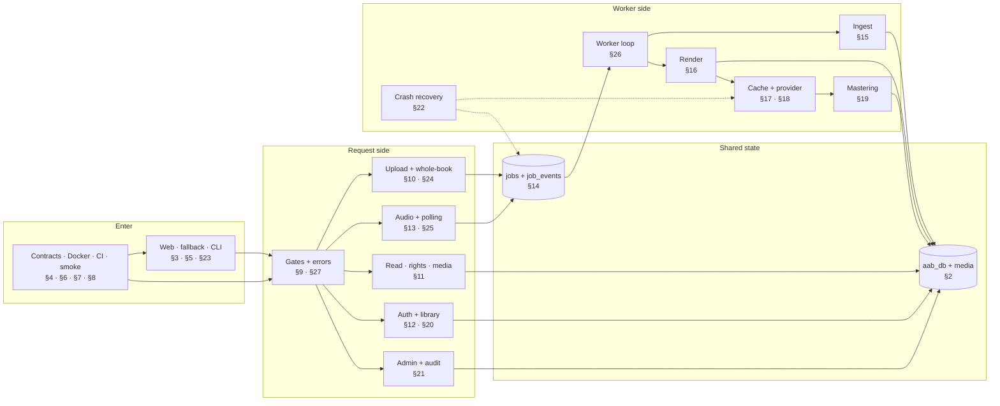

If you need literal pan/zoom over every diagram at once, the alternative is a standalone HTML/SVG
viewer; Mermaid in Markdown cannot do that natively.

## 1. Directory dependency map

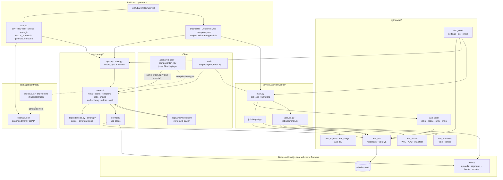

Import direction: `aab_core` imports nothing from the project; `aab_db` owns every SQL statement;
only `aab_providers` knows a vendor exists. The HTTP layer never imports worker handlers, and
the worker never imports FastAPI.

## 2. Data directory flow

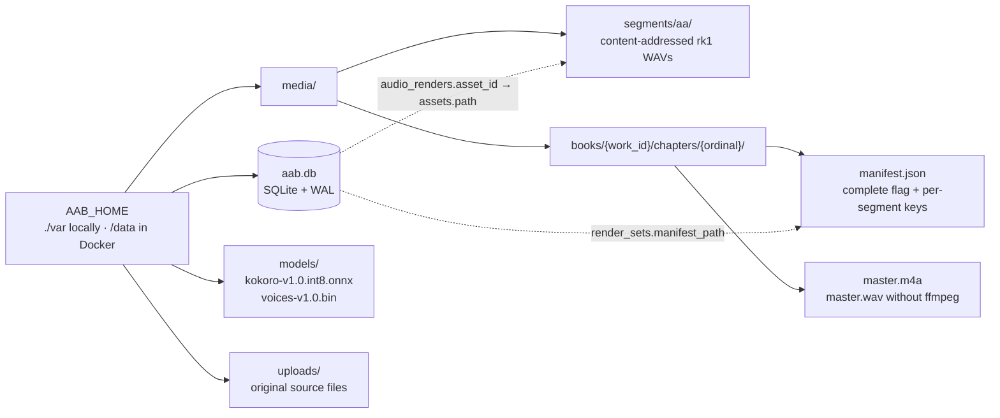

Rendered bytes are immutable and content-addressed by `render_key`; the database stores paths,
not blobs. Deleting `aab.db` leaves orphaned audio; deleting `media/` breaks every render row.

## 3. Web delivery flow

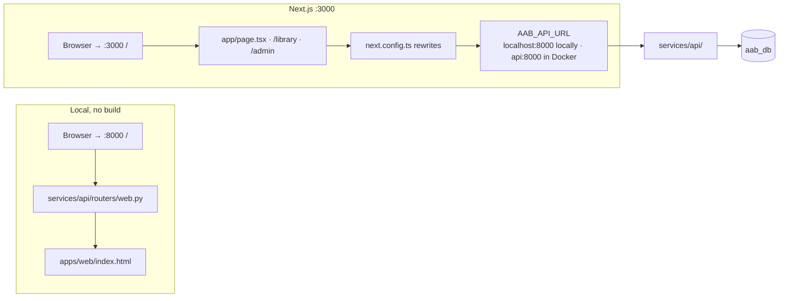

The zero-build page is served straight from the API and needs no Node toolchain. The typed app
keeps the browser same-origin (`/api/*`, `/media/*`), which is what lets HttpOnly refresh cookies
and `?token=` media URLs behave identically in both modes.

## 4. Contract generation flow

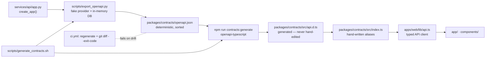

The FastAPI schema is the single source of truth. `api.d.ts` and `openapi.json` are committed so
the web image can build with Node only.

## 5. Local development flow

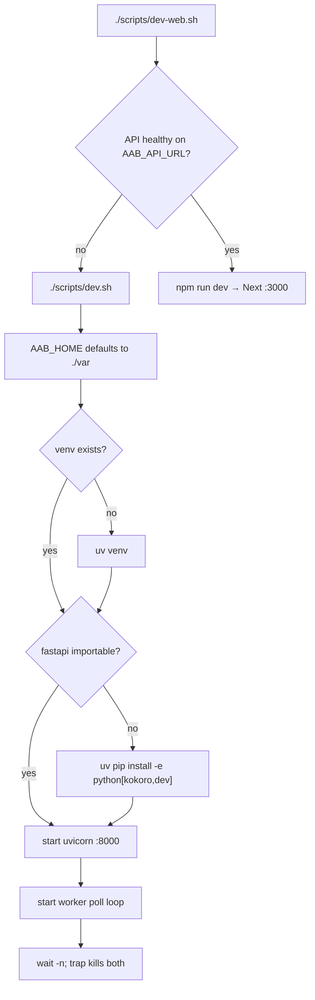

## 6. Docker runtime flow

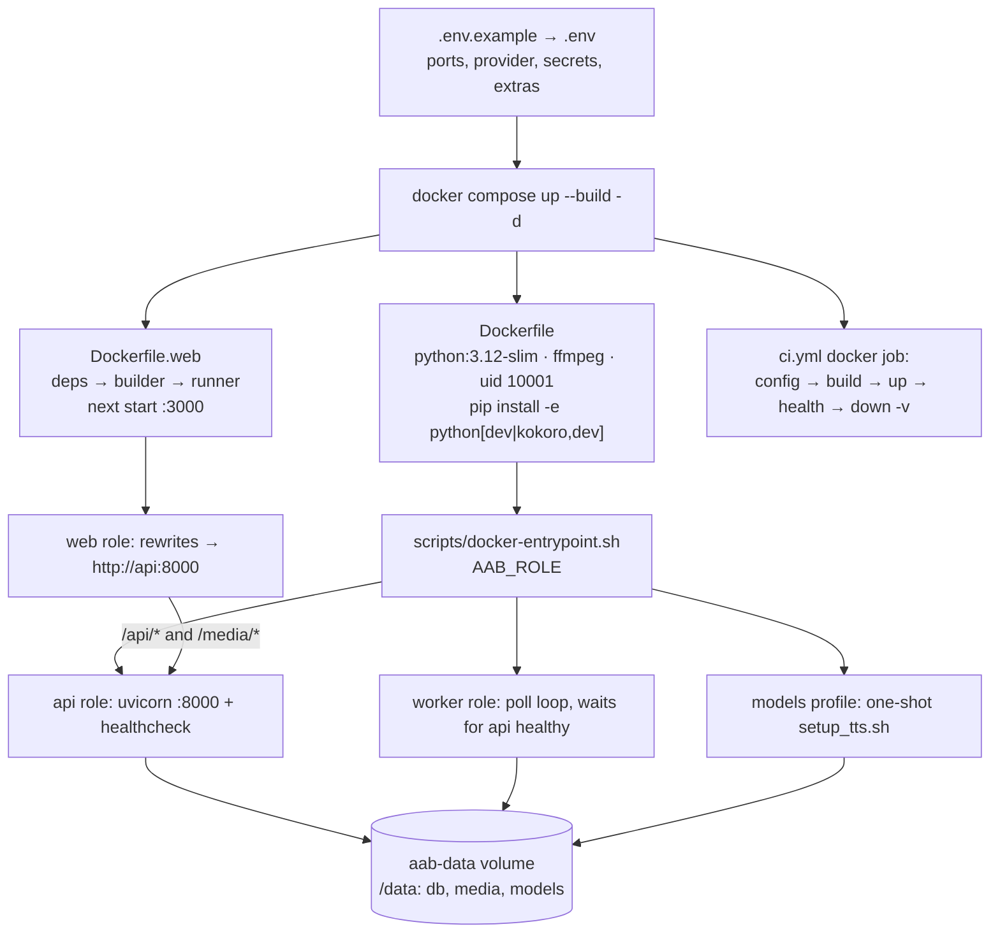

`AAB_ROLE=all` (the default for a bare `docker run`) starts the API and worker in one container;
Compose runs them as separate services. Secrets stay in `.env`, never in the image.

## 7. CI flow

```mermaid
flowchart TD
  PUSH["push / pull_request"] --> VJOB
  PUSH --> DJOB
  subgraph VJOB["verify"]
    V1["setup-python 3.11 + setup-uv + setup-node 20"] --> V2["uv venv; uv pip install -e python[dev]"]
    V2 --> V3["npm ci"]
    V3 --> V4["pytest python/tests"]
    V4 --> V5["scripts/smoke.sh — HTTP e2e, fake voice"]
    V5 --> V6["generate contracts; git diff --exit-code"]
    V6 --> V7["npm run typecheck"]
    V7 --> V8["npm run build"]
  end
  subgraph DJOB["docker"]
    D1["docker compose config --quiet"] --> D2["docker compose build"]
    D2 --> D3["docker compose up -d"]
    D3 --> D4["poll :8000/api/v1/health and :3000/"]
    D4 --> D5["docker compose down -v, always"]
  end
```

## 8. HTTP smoke flow

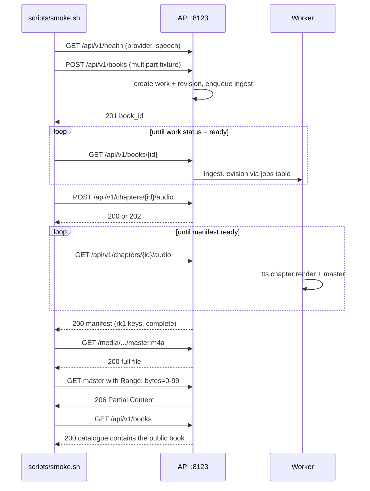

## 9. Request pipeline and error envelope

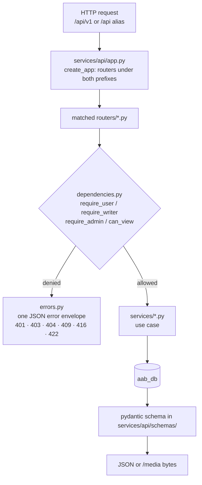

`/api/v1` is canonical; `/api` is an alias for the shared routers. Auth, library and admin are
v1-only. `require_writer` accepts the operator token or any authenticated account;
`require_admin` accepts the operator token or a JWT with `role=admin` and gates every admin route.
`require_user` requires a real account — the operator token alone does not satisfy it.
`GET /api/v1/jobs/{job_id}` has no gate; job ids are opaque but unscoped.

## 10. Upload and ingest request flow

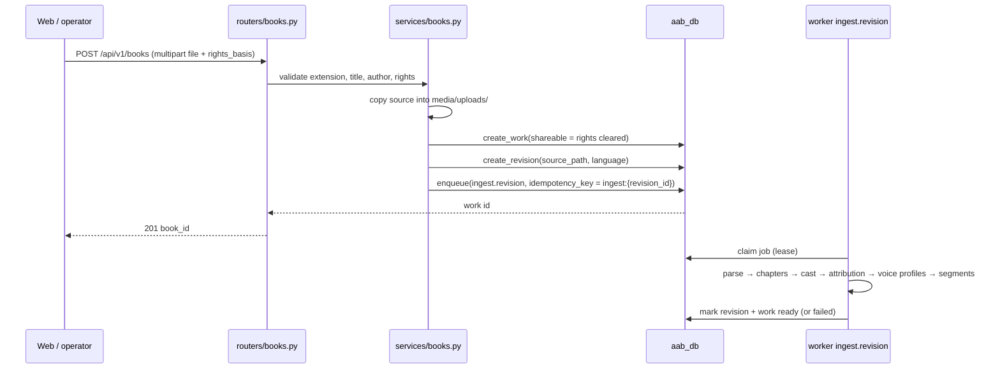

`rights_basis` is per work and `shareable` is derived from it at creation; `can_view` is a
query-time predicate, never an assumption. The UI defaults new uploads to `public_domain_us`,
but a parse failure marks both revision and work `failed` instead of leaving them pending.
`POST /books/{id}/generate` and `POST /chapters/{id}/audio` use `require_writer` only — they do
**not** call `can_view` — while the corresponding `GET` routes do.

## 11. Read, rights and media flow

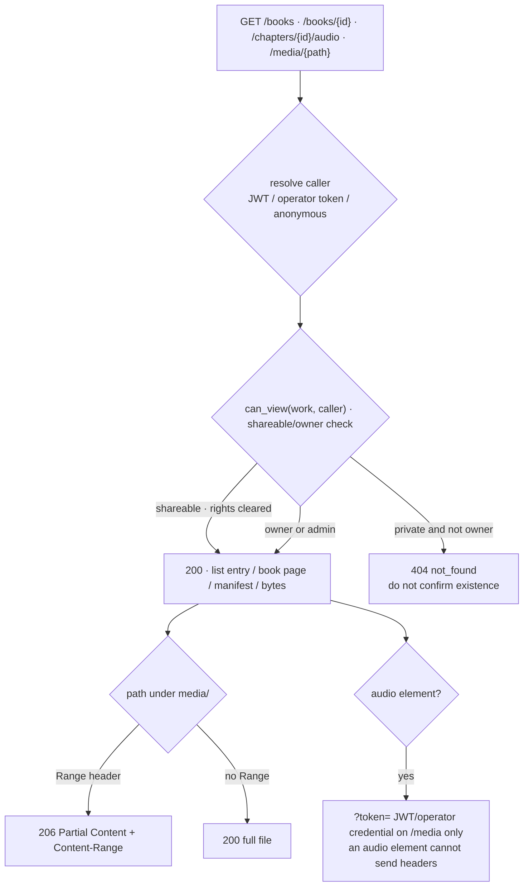

The anonymous catalogue only contains works whose rights allow sharing. A private work is absent
from listings and returns `404` on its page, manifest and media to callers without a token. Media
resolves paths against `media_dir` with a traversal guard, and non-admins may only read
`media/books/{work_id}/...` for a shareable work they own; `uploads/` and raw `segments/` are
operator-only. `?token=` is accepted **only** on `/media`, because an `<audio>` element cannot
send headers. Range support is `bytes=start-end` with an open end allowed and the end clamped to
the file size; suffix ranges, `ETag`/`If-Range` and `HEAD` are not implemented.

## 12. Authentication flow

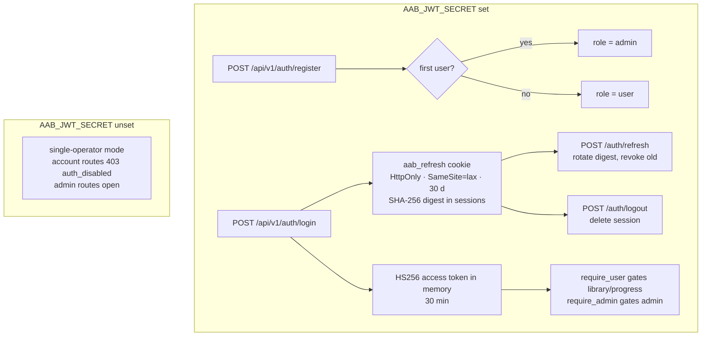

The browser keeps the access token in memory only and calls `/auth/refresh` on mount; the refresh
cookie is scoped to `/api/v1/auth` and is `Secure` when `AAB_PUBLIC_BASE_URL` is HTTPS. Roles are
read from JWT claims at request time, not re-read from `users.role`. Works carry `owner_id`, while
the table is `library_entries` and is scoped by `user_id`. Private works are visible to the owner,
admins and the operator token only.

## 13. Audio generation and playback flow

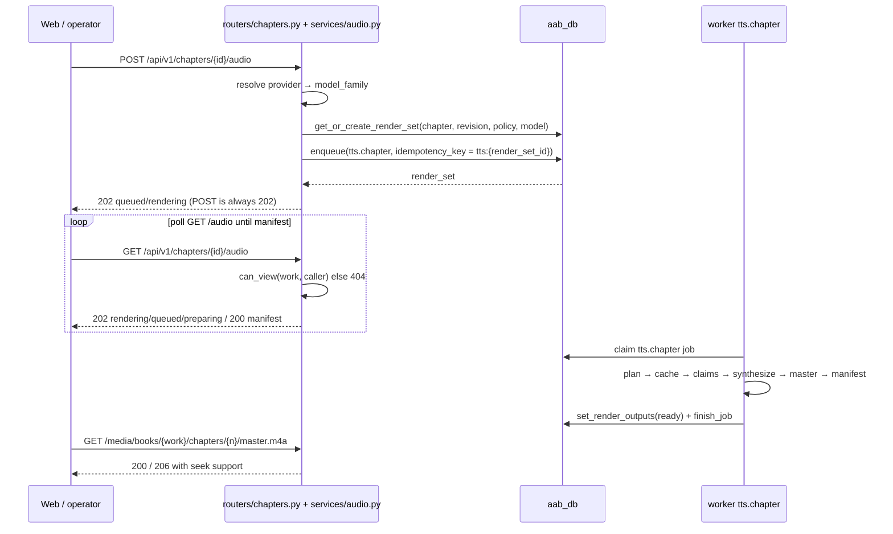

The player deep link `/?book=<id>` restores a selected work, and
`/api/v1/library/progress/…` restores the listening position per chapter.

## 14. Job lifecycle

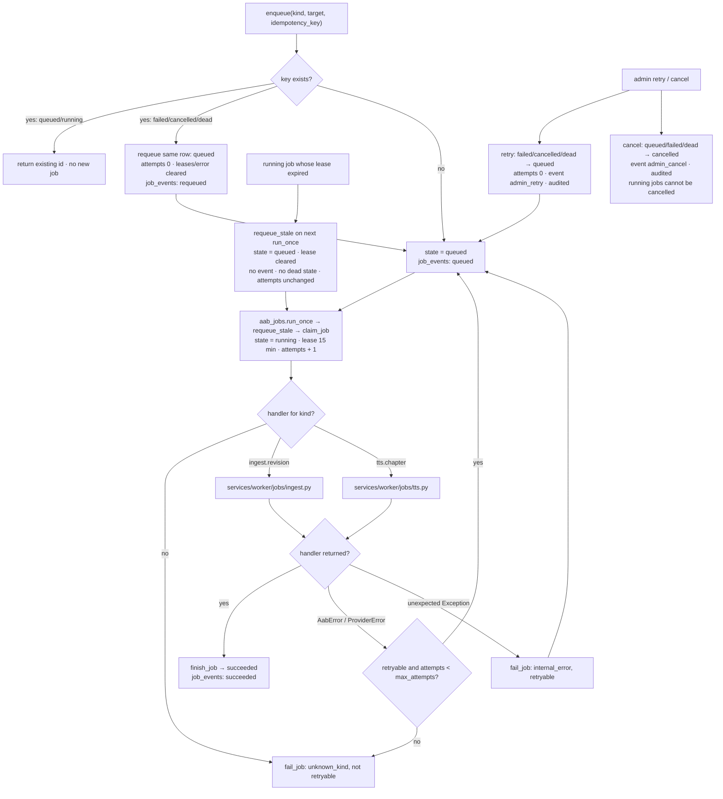

There is no broker: the `jobs` table is the queue. `drain()` is used by tests, `--once` and the
CLI; the long-running worker polls the same functions. Running jobs cannot be cancelled in v1.

## 15. Ingest handler flow

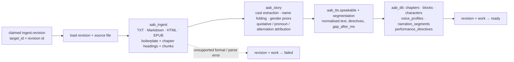

Each narrator and character gets a distinct preset in `voice_profiles`; the character id is
never part of a render key.

## 16. TTS render handler flow

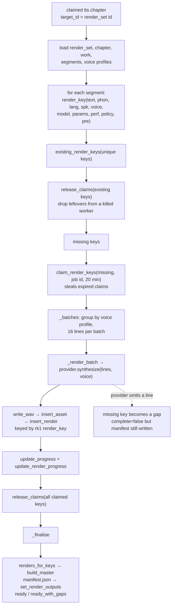

The seed inside `params` is derived from the text, not from the segment id. That is what makes
an identical line in two books resolve to the same key. Claims make concurrent workers unable to
synthesise the same key twice; expired claims are stolen on the next attempt.

## 17. Cache reuse and voice invalidation

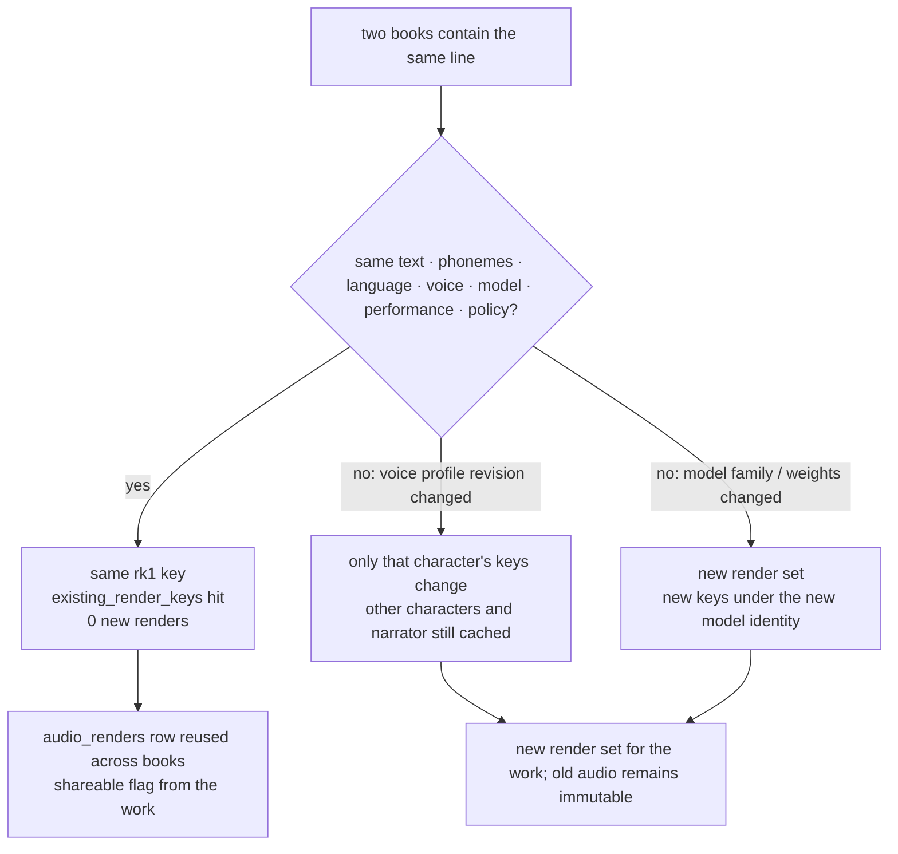

A fallback model therefore produces a *new render set*, never a new voice mid-book. The manifest
records model family, policy version and every render key so substitutions are never silent.

## 18. Provider selection

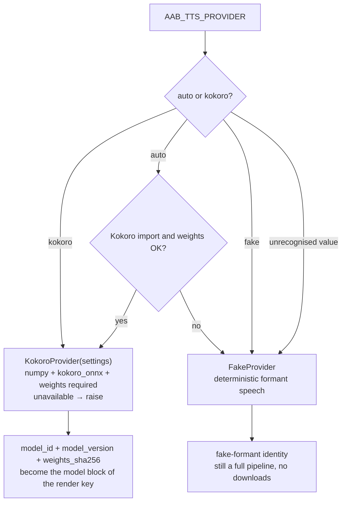

Only `aab_providers` knows a vendor exists. Health reports which provider is live; a paid
provider would be one more module plus a registry entry (ADR-0005).

## 19. Mastering and delivery

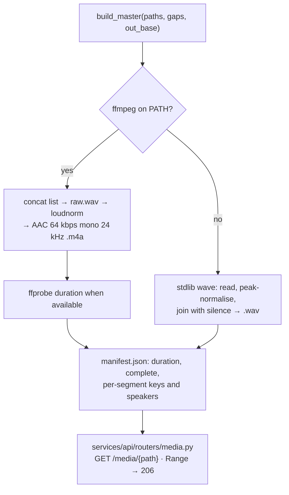

The ffmpeg branch produces `.m4a` and is used whenever the binary is present; the Docker image
installs it. Without ffmpeg the stdlib branch produces `.wav`. `ffprobe` duration parsing also
falls back to a `wave` frame count on any failure.

## 20. Library and progress

```mermaid
flowchart LR
  USER["signed-in user · require_user"] --> LIB["GET /api/v1/library/ · POST/DELETE works/{id}<br/>library_entries scoped by user_id"]
  USER --> PROG["PUT/GET /api/v1/library/progress/{chapter}<br/>GET works/{id}/progress<br/>playback_progress scoped by user_id"]
  LIB --> UI["apps/web/app/library/page.tsx<br/>shelf + deep link /?book=id"]
  PROG --> PLAY["apps/web/components/PlayerApp.tsx + PlayerBar.tsx<br/>resume playback"]
  OWNER["another account / operator token / anonymous"] --> DENY["401 login required or 404 · no cross-user data"]
```

Account routes return `403 auth_disabled` when `AAB_JWT_SECRET` is unset; the instance keeps its
single-operator behavior. Adding a work or saving progress validates that the id exists but does
not call `can_view`; `user_id` scoping prevents cross-user library and progress reads.

## 21. Admin mutations and audit

```mermaid
flowchart TD
  UI["apps/web/app/admin/page.tsx<br/>overview · jobs · books · flags · providers"] --> TYPE["apps/web/lib/api.ts api.admin*"]
  TYPE --> GATE["require_admin(request)"]
  GATE --> TX["services/api/services/admin.py<br/>one engine.begin() transaction"]
  TX --> CHANGE["retry · cancel · work shareable/status<br/>flag set (upsert) / delete"]
  TX --> AUDIT["record_admin_action<br/>admin_audit row: actor · before · after · reason"]
  CHANGE --> EVENTS["job_events: admin_retry / admin_cancel"]
  PROVIDERS["GET providers · read-only registry"] --> GATE
```

Every admin route is gated by `require_admin` at the router level. The exact canonical routes are:

| Route | Purpose |
|---|---|
| `GET /api/v1/admin/overview` | counts, queue depth, recent `admin_audit` rows |
| `GET /api/v1/admin/jobs` | filtered/paginated job list |
| `GET /api/v1/admin/jobs/{job_id}` | job detail plus `job_events` timeline |
| `POST /api/v1/admin/jobs/{job_id}/retry` | `failed/cancelled/dead` → `queued`, attempts reset, `admin_retry` event |
| `POST /api/v1/admin/jobs/{job_id}/cancel` | `queued/failed/dead` → `cancelled`, `admin_cancel` event; running jobs are not cancelable |
| `GET /api/v1/admin/works` | all works, including private |
| `PATCH /api/v1/admin/works/{work_id}` | change `shareable` and/or `status` |
| `GET /api/v1/admin/flags` | list feature flags |
| `PUT /api/v1/admin/flags/{key}` | upsert a flag |
| `DELETE /api/v1/admin/flags/{key}` | delete a flag |
| `GET /api/v1/admin/providers` | read-only provider registry |

That is eleven routes; the UI groups them into five tabs (overview, jobs, books, flags,
providers). Every mutation requires a typed reason; the audit row and the change commit in one
`engine.begin()` transaction. Full audit browsing, budgets and provider routing remain deferred.

## 22. Crash recovery and the kill drill

```mermaid
sequenceDiagram
  participant W1 as worker 1
  participant DB as jobs + render_claims
  participant W2 as worker 2
  W1->>DB: claim tts.chapter (lease 15 min)
  W1->>DB: claim render keys, write first batch
  W1--xW1: SystemExit — simulated SIGKILL
  Note over W1,DB: job stays running, claims held, no _finalise
  W2->>DB: run_once → requeue_stale (lease still live)
  DB-->>W2: no job — refuses to duplicate work
  W1->>DB: expire lease and claims (timeout)
  W2->>DB: requeue_stale → queued, claim job
  W2->>DB: existing keys skipped, orphan claims released
  W2->>DB: render remaining batches, release claims
  W2->>DB: set_render_outputs(ready), finish_job
  Note over W2: manifest complete, one render per key
```

`python/tests/test_resilience.py` performs this drill. It also exposed the orphan-claim leak:
keys rendered before the kill were never released on recovery, fixed by
`release_claims(existing)` during planning.

## 23. CLI import flow

```mermaid
flowchart LR
  CMD["scripts/import_book.py path/to/book.epub<br/>--title --author --chapter"] --> SET["AAB_TTS_PROVIDER, AAB_MODELS_DIR, AAB_HOME"]
  SET --> STORE["copy source into media/uploads/"]
  STORE --> CREATE["create work + revision + enqueue ingest"]
  CREATE --> DRAIN["aab_jobs.drain(engine, worker_id, HANDLERS, settings)"]
  DRAIN --> OUT["media/books/{work}/chapters/{n}/master.m4a<br/>+ manifest.json"]
```

`--chapter 0` renders every chapter; `--chapter 2` renders only the second.

## 24. Whole-book generation flow

```mermaid
sequenceDiagram
  participant U as Web / operator
  participant API as routers/books.py + services/audio.py
  participant DB as aab_db
  participant W as worker
  U->>API: POST /api/v1/books/{id}/generate
  API->>API: require_writer (no can_view)
  API->>DB: db.get_work + db.list_chapters
  loop every chapter
    API->>DB: get_or_create_render_set(chapter, policy, model_family)
    API->>DB: enqueue(tts.chapter, idempotency_key = tts:{render_set_id})
    API->>DB: set render_sets.job_id
  end
  API-->>U: 202 GenerateResult (chapters, jobs_created)
  W->>W: drain queued tts.chapter jobs
  U->>API: poll GET chapter audio and GET books for progress
```

`jobs_created` counts only newly enqueued jobs; an existing `queued`/`running` job is reused, and a
previous `failed`/`cancelled`/`dead` row is requeued in place. The browser entry point is
`PlayerApp.generateAll()` behind the “Generate all” button in `BookDetail`.

## 25. Job status and health polling flows

```mermaid
flowchart LR
  subgraph P["Job status"]
    JREQ["GET /api/v1/jobs/{job_id}<br/>ungated"] --> JDB["db.get_job"]
    JDB --> JOUT["id · kind · state · progress · total · error"]
  end
  subgraph H["Health"]
    HREQ["GET /api/v1/health<br/>also /api/health alias"] --> HSVC["routers/meta.py health()"]
    HSVC --> HDB["db.queue_depth"]
    HSVC --> HSVC2["status · provider · provider_version<br/>speech · queue · auth_required"]
  end
  WEB["PlayerApp + useHealth"] -- "every 30 s" --> HREQ
  WEB -- "every 12 s" --> BOOKS["GET /api/v1/books"]
  WEB -- "every 1.5 s while rendering" --> RENDER["GET /api/v1/chapters/{id}/audio"]
  WEB --> JREQ
```

`auth_required` is `bool(AAB_ADMIN_TOKEN or AAB_JWT_SECRET)`. Health never contacts a TTS model or
a provider; it only reports the configured provider identity and local queue depth.

## 26. Worker loop modes

```mermaid
flowchart TD
  START["python -m services.worker.worker.main"] --> SET["Settings.load → make_engine → init_db"]
  SET --> ONCE{"--once?"}
  ONCE -- yes --> DRAIN["aab_jobs.drain<br/>run_once until empty · 10 000 job safety stop"]
  DRAIN --> EXIT["process exits"]
  ONCE -- no --> SIG["install SIGINT / SIGTERM handlers"]
  SIG --> LOOP["run_once: requeue_stale → claim_job"]
  LOOP --> GOT{"job claimed?"}
  GOT -- yes --> HAND{"handler registered?"}
  HAND -- yes --> RUN["handler: ingest.revision or tts.chapter"]
  HAND -- no --> UNK["fail_job unknown_kind · non-retryable"]
  RUN --> LOOP
  UNK --> LOOP
  GOT -- no --> IDLE["sleep 1 s"]
  IDLE --> LOOP
  LOOP -. "exception outside run_once" .-> BACK["sleep 2 s"]
  BACK --> LOOP
  SIG -. "signal" .-> STOP["set stop flag; exit after current run_once"]
```

`--once` is used for deterministic tests and local drains; the long-running worker uses the same
`run_once` function in a signal-aware loop. In Docker the `worker` role execs this module and waits
for the API healthcheck before polling.

## 27. Route surface and gates

```mermaid
flowchart LR
  ROOT["Route surface"] --> SHARED["/api/v1 + /api<br/>health · books · chapters · jobs"]
  ROOT --> AUTH["/api/v1/auth<br/>register · login · refresh · logout · me"]
  ROOT --> LIBR["/api/v1/library<br/>list · add · remove · progress get/set · book progress"]
  ROOT --> ADM["/api/v1/admin<br/>11 routes listed in §21"]
  ROOT --> MED["/media/{path}<br/>allow_query=True · range support"]
  ROOT --> WEBR["/<br/>apps/web/index.html fallback"]
```

| Group | Exact routes | Gate |
|---|---|---|
| Shared | `GET /health`, `GET /books`, `GET /books/{book_id}`, `POST /books`, `POST /books/{book_id}/generate`, `POST /chapters/{chapter_id}/audio`, `GET /chapters/{chapter_id}/audio`, `GET /jobs/{job_id}` | `GET` routes public with visibility filtering; `POST` routes `require_writer`; `GET /jobs/{id}` ungated |
| Auth | `POST /register`, `POST /login`, `POST /refresh`, `POST /logout`, `GET /me` under `/api/v1/auth` | account existence via `AAB_JWT_SECRET`; `GET /me` uses `require_user` |
| Library | `GET /`, `POST /works/{work_id}`, `DELETE /works/{work_id}`, `PUT /progress/{chapter_id}`, `GET /progress/{chapter_id}`, `GET /works/{work_id}/progress` under `/api/v1/library` | `require_user` and `user_id` scoping |
| Admin | the 11 routes in §21, all under `/api/v1/admin` | router-level `require_admin` |
| Static | `GET /media/{path:path}`, `GET /` | media visibility/owner check; traversal guard; `/` public |

Legacy `GET /api/books` returns a bare list; `GET /api/v1/books` returns a paginated `BookPage`.
All other shared routes exist identically under both prefixes.

## 28. Flow index

| Flow | Entry point | Tables / output |
|---|---|---|
| Web delivery | `services/api/routers/web.py`, `apps/web/next.config.ts` | `apps/web/index.html`, `.next/` |
| Contracts | `scripts/export_openapi.py` → `scripts/generate_contracts.sh` | `openapi.json`, `api.d.ts` |
| Local dev | `scripts/dev.sh`, `scripts/dev-web.sh` | API :8000, worker, Next :3000 |
| Docker | `compose.yaml`, `scripts/docker-entrypoint.sh` | `aab-data` volume |
| CI | `.github/workflows/ci.yml` | test, smoke, contract, build, Docker gates |
| HTTP smoke | `scripts/smoke.sh` | health → upload → ingest → render → 200/206 media |
| Upload | `POST /api/v1/books` | `works`, `revisions`, `uploads`, `jobs` |
| Whole-book generation | `POST /api/v1/books/{id}/generate` | `render_sets`, `jobs` |
| Chapter audio request | `POST /api/v1/chapters/{id}/audio` | `render_sets`, `jobs` |
| Read / rights | `GET /api/v1/books`, `GET /books/{id}`, `GET /chapters/{id}/audio` | 200 / 202 / 404 |
| Media delivery | `GET /media/{path}` | 200 / 206 / 404 / 416 |
| Job status / health | `GET /api/v1/jobs/{id}`, `GET /api/v1/health` | job state, provider identity, queue depth |
| Auth | `/api/v1/auth/*` | `users`, `sessions` |
| Ingest | `services/worker/worker/jobs/ingest.py` | `chapters`, `blocks`, `characters`, `voice_profiles`, `narration_segments`, `performance_directives` |
| Render | `services/worker/worker/jobs/tts.py` | `audio_renders`, `assets`, `render_claims`, manifest |
| Job lifecycle | `aab_jobs.run_once`, `aab_db.enqueue` | `jobs`, `job_events`, `render_claims` |
| Mastering | `aab_audio.build_master` | `master.m4a` / `master.wav`, `manifest.json` |
| Library | `/api/v1/library/*` | `library_entries`, `playback_progress` |
| Admin | 11 routes under `/api/v1/admin` | `admin_audit`, `job_events` |
| Worker modes | `python -m services.worker.worker.main [--once]` | drain or signal-aware poll loop |
| CLI import | `scripts/import_book.py` | work, revision, drain, manifest |
